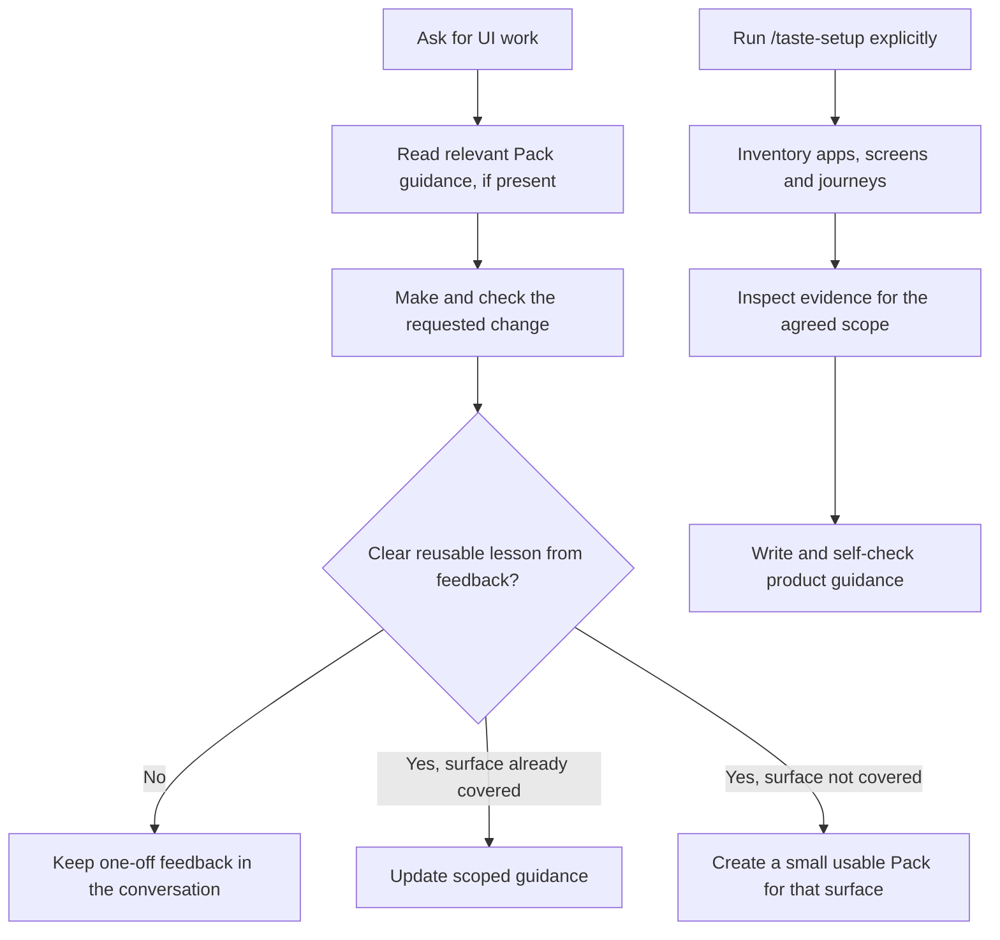

<h1 align="center">Taste</h1>
<p align="center"><strong>Help coding assistants make product screens feel like they belong together.</strong></p>
<p align="center">
  <a href="LICENSE"></a>
  <a href="docs/prd.md"></a>
</p>
<p align="center"><a href="#how-taste-works">How it works</a> · <a href="#inside-a-pack">Inside a Pack</a> · <a href="#set-up-taste">Set up</a> · <a href="#contribute">Contribute</a></p>

Taste helps a coding assistant learn how a particular product should look and behave: its visual style, interactions, language, and user experience. The assistant can use that product knowledge across screens and tasks instead of relying on you to repeat it in every prompt.

Taste works with [Cursor](https://cursor.com/), [Codex](https://developers.openai.com/codex), and [Claude Code](https://code.claude.com/). Each product keeps its own **Taste Pack** in a `taste/` folder in its repository. The Pack is versioned beside the product code and can be shared by anyone working on that product.

## How Taste works

Taste is a set of focused instructions and tools that your coding assistant can call when they are useful. It is not a separate coding agent. The assistant you already use does the product work; Taste helps it find and retain the product's design guidance.

This repository ships seven Taste Skills: setup, sweep, design, conformance, expression, Pack maintenance, and evaluation. They describe when to inspect product guidance, how to work with it, and how to learn from feedback.

For ordinary UI work, the assistant reads guidance for the affected surface, makes the requested change, and checks its work. When you correct a design choice, the assistant applies the correction. If the feedback establishes a clear lesson worth reusing, it updates the relevant guidance. If no Pack covers that surface, it creates a small Pack for that surface. One-off reactions stay in the conversation. This learning does not start a product-wide sweep.

Use `/taste-setup` in Cursor, or invoke Taste's `taste-setup` Skill in another supported assistant, when you want a broader product inspection. Setup inventories the repository, identifies apps and journeys, chooses a scope, inspects accessible UI and source, then writes product-specific guidance. If part of the product is inaccessible, it records the gap and continues with other accessible parts. The assistant checks its own guidance; no separate human approval step is required.



## Inside a Pack

A Pack contains only the product knowledge that helps an assistant make better decisions. Its exact files depend on the product; this is an example shape, not a required template:

```text
product-repository/
└── taste/
    ├── README.md
    ├── manifest.json
    ├── skills/
    │   └── product-design/
    │       ├── SKILL.md
    │       └── references/
    │           ├── surfaces/
    │           │   └── account-settings.md
    │           └── checklists/
    │               └── account-settings.md
    ├── metadata/                 # Optional authority or source notes
    └── evals/                    # Optional examples for checking guidance
```

- **`SKILL.md`** is the entry point. It routes the current task to the relevant product and surface guidance.
- **References** capture product-specific patterns, facts, examples, and exceptions. A reference should say when a rule applies and why, not just name a preferred style.
- **Guidance** can use direct rules, checklists, decision trees, or annotated examples. Choose the form that helps the next assistant make the decision. Record when it applies, why it matters, which settled alternatives were rejected and why, its limits, and the supporting evidence. Cite product evidence for examples.
- **`manifest.json`** records Pack readiness, the covered product surfaces, and evidence for those coverage claims.
- **Metadata and evaluations** are optional. Add them only when the product benefits from them; Taste does not require a fixed set of files.

For example, a checklist entry might say:

```markdown
## Keep entered values after a validation error

- **Check:** When saving fails validation, preserve the user's valid entries so they can fix only the fields with errors.
- **Applies to:** The account settings form.
- **Why:** Re-entering valid information adds effort and can cause users to abandon the task.
- **Evidence:** `src/settings/AccountForm.tsx` (source reviewed, 2026-11-04).
- **Coverage:** The source behavior was reviewed; rendered behavior has not been verified.
```

This example is illustrative, not a rule for every product. A Pack should cite the product evidence behind its own guidance. A Pack marked `usable_partial` supports only the surfaces recorded in its coverage; `complete` means the agreed setup scope met its coverage target and Pack checks passed.

## Why Taste is designed this way

Coding models can produce working interfaces, but without product context they tend to fall back on familiar patterns. Taste addresses that by giving the assistant focused, product-specific guidance when it is relevant, and by connecting that guidance to evidence and reasons.

The approach draws on several published systems and methods:

- [Vercel's product-design system](https://vercel.com/blog/teaching-agents-product-design-at-vercel) shows how repository-owned Skills can route by task and surface, while product rules, examples, evidence, and mechanical checks stay close to the code they govern. Taste uses that as a starting point and lets each product choose the guidance it needs.
- [LangChain's design agent](https://www.langchain.com/blog/design-agent) describes combining expert judgment in Skills and checks with feedback and evaluation. Taste borrows the knowledge-layer and evaluation ideas; it does not include LangChain's agent runtime or hosted environment.
- [Anthropic's frontend Skills article](https://claude.com/resources/articles/improving-frontend-design-through-skills) explains how focused Skills can give models design context only when a UI task needs it, helping avoid generic output without loading frontend rules into every task.
- [Emil Kowalski's “Agents with Taste”](https://emilkowal.ski/ui/agents-with-taste) demonstrates how to turn visual judgment into concrete, scenario-based guidance with reasons—for example, how an animation should enter, move, or respond to hover. Taste applies the same idea across product-specific surfaces and tasks, while keeping rules tied to evidence and scope.

Taste applies these ideas with evidence labels and source references: the assistant should distinguish what it saw in the running product from what it learned from source code, design files, or inference. It should record coverage gaps rather than turn a small sample into a product-wide rule.

These sources inform Taste's design; they do not prove that Taste improves results. The project's evaluation approach is to compare the same task with and without relevant guidance, keep the conditions as similar as practical, and score following product rules separately from similarity to existing UI. Examples held back from authoring can help check whether guidance generalizes. See [Engineering design](docs/engineering.md) for the full rationale and evaluation details.

## Set up Taste

There are two setup steps: install Taste in your coding assistant, then set up product guidance in the product repository.

### 1. Install the plugin

Taste requires Node.js 20 or later. Its bundled server is included in the repository.

<details>
<summary><strong>Cursor</strong></summary>

From the Taste checkout:

```sh
mkdir -p ~/.cursor/plugins/local/taste
rsync -a \
  --exclude .git \
  --exclude plugin.json \
  --exclude mcp.json \
  --exclude .mcp.json \
  --exclude .claude-plugin \
  --exclude .claude.mcp.json \
  --exclude .codex-plugin \
  --exclude .agents \
  ./ ~/.cursor/plugins/local/taste/
```

Reload Cursor and check **Customize** for Taste. Your organization may need to allow local plugins.

</details>

<details>
<summary><strong>Codex</strong></summary>

Open the Taste repository in Codex and select the `taste-local` marketplace from `.agents/plugins/marketplace.json`. Or add it from the CLI:

```sh
codex plugin marketplace add /absolute/path/to/taste
```

</details>

<details>
<summary><strong>Claude Code</strong></summary>

Add this repository as a plugin marketplace and install Taste (persists across sessions):

```sh
claude plugin marketplace add gksoriginals/taste
claude plugin install taste@taste
```

To try a local checkout for one session instead, launch Claude Code with `claude --plugin-dir /absolute/path/to/taste`.

</details>

### 2. Create a product Pack

Open the product repository in your coding assistant and run `/taste-setup` in Cursor, or invoke the `taste-setup` Skill in another supported assistant. Setup inspects the repository before choosing scope. It asks which product or app to start with only when that choice materially changes what gets covered. It creates guidance from available product UI, source, documentation, and optional design files.

If you do not want a broad sweep, just work on the UI normally. A clear, reusable correction can create a small Pack for its surface during that task. Setup is for broader coverage; it is not required before you can ask for design work.

For host packaging details, see the [plugin development guide](docs/plugin-development.md).

## Contribute

Start with the [contributor guide](CONTRIBUTING.md). In brief: use Node.js 20 or later, install dependencies, make a focused change, and run the project checks:

```sh
npm ci
npm run build
npm run typecheck
npm test
npm run validate:package
```

Changes to `src/` require rebuilding the committed `dist/server.js`. For changes that affect plugin loading, validate the affected host when available and report only checks you actually ran. Keep product-specific decisions in product Packs, not as generic Taste rules.

## More information

- [Product direction](docs/prd.md)
- [Engineering design](docs/engineering.md)
- [Plugin development](docs/plugin-development.md)
- [Validation results](docs/validation-results.md)
- [Contributing](CONTRIBUTING.md)
- [Security](SECURITY.md)

Taste is an early project. Package checks do not establish that it improves a real product; try it in your coding assistant and product repository.

## License

[MIT](LICENSE) © 2026 Gopikrishnan Sasikumar
