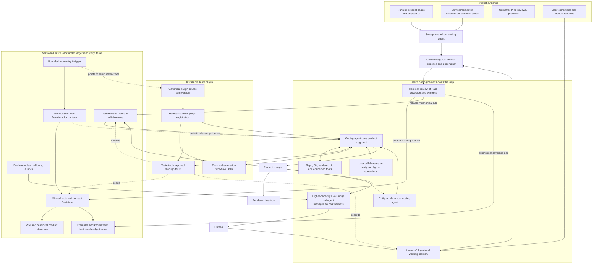
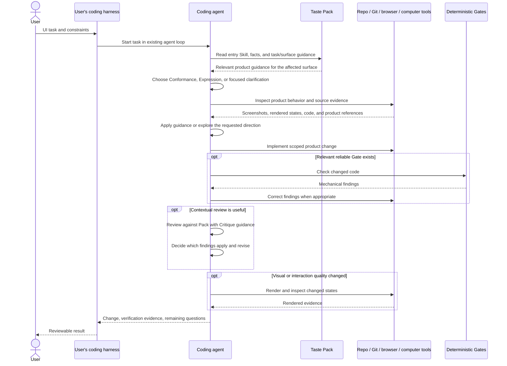
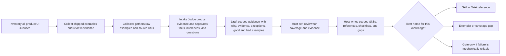
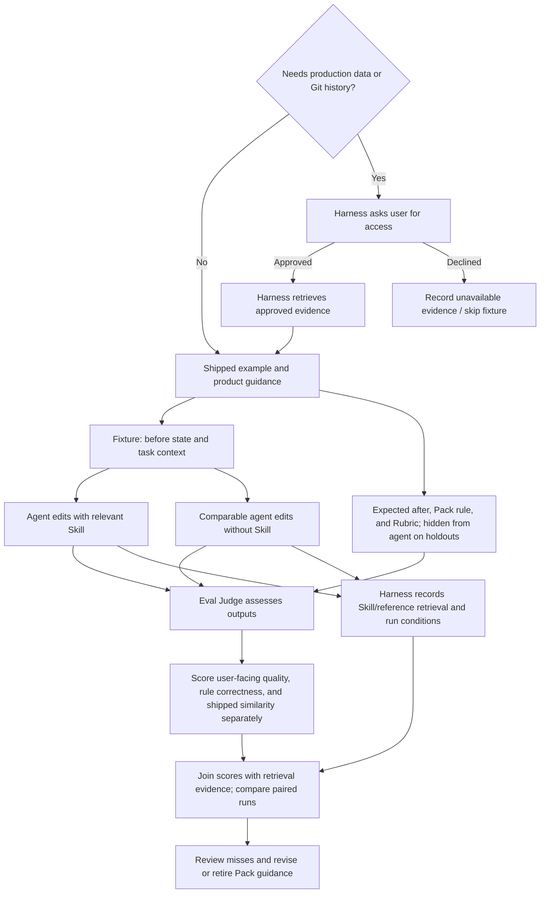
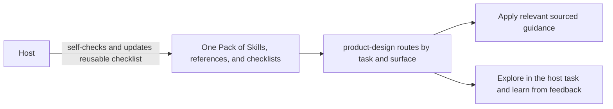

# Engineering

**Draft · Oct 30, 2026 IST**

## Purpose and status

This document describes a possible system design for Taste: its responsibility, major components, and how they might work together. It is not an implementation plan or a locked architecture. Keep the product direction clear while allowing the system shape to change as Taste is used.

Taste's ambition remains the one in the [PRD](prd.md): extract the taste in a shipped product so a coding harness, given a PRD and the Taste Pack, can produce a first pass the user would merge. The ambition is the destination, not a requirement to settle every architectural question now.

Align this document with the current [PRD](prd.md) and implementation. The PRD is the product source of truth. An earlier author-private draft is optional and does not override it.

This repository contains the Taste plugin implementation and documentation. Example product Packs live under `examples/`; real Packs live in their target repositories.

## Product boundaries and direction

### Current host learning flow (Nov 3 update)

The host harness owns implementation, product checks, self-review, and push. Taste does not run or observe those workflows. When the user explicitly invokes `/taste-setup`, the host inspects repository instructions and structure, chooses a bounded scope, then builds a product-specific Pack and self-checks it. Routine UI tasks do not create or refresh setup. With an existing complete Pack, resolved reusable user feedback can still update the relevant checklist after the host applies and self-checks the result. `taste_record_signal` remains a legacy structured Decision tool. `decisionPromotionCheckpoint` is not required for the active checklist learning loop.

Taste is a plugin for existing coding harnesses (Cursor, Codex, Claude Code). It supplies Skills and MCP tools. It does not run a daemon, and this milestone does not add a hard CI gate. The Pack lives in the product repository at `taste/`, not in this plugin repository.

- A **Pack** carries one product's design judgment. Conformance and Expression are host approaches to tasks, not persistent Pack states or separate trees.
- **Expression** explores new directions, handles gaps, and responds to corrections. Resolved reusable feedback can become a scoped checklist item during the same task.
- **Conformance** applies the product's sourced guidance and relevant checklists. Legacy structured Decisions remain readable but do not route ordinary checklist-based work.
- The **coding harness** owns the agent loop, planning, models, tools, and PR workflow.

Taste does not configure or run an agent. Taste is not a component library or design-system product. Product-specific design judgment belongs to the product.

Route ordinary tasks from the user's request and affected product surface. Apply established sourced guidance (Conformance), explore a new direction/gap/correction (Expression), or ask a focused question when intent or scope remains materially unclear. Existing guidance can still apply during Expression work. `taste_part_state` remains for legacy structured Decision compatibility and diagnostics; it is not the normal routing authority for checklist-based Packs. `supportedModes` on older manifests is deprecated metadata. If no Pack exists, keep guidance task-local until explicit setup.
No particular product is a blocker. The milestone succeeds when a harness can run the explicit setup command, resume interrupted setup, perform UI work without implicit setup, and learn from a correction in an existing Pack.

Shipped work is evidence of what a product does. The host distinguishes observed patterns from inferred intent and records sources and confidence. Known flaws should be noted so similarity to shipped code is not mistaken for quality. The user's explicit correction in the current task remains the immediate authority and can update a checklist after the host applies and self-checks it.

## System at a glance



This is the high-level architecture proposed from the linked proof-of-concepts, not a deployment diagram. [LangChain's Content Studio](https://www.langchain.com/blog/design-agent) provides the knowledge-layer starting point—Skills, Wiki, Gates, and Memory—and [Anthropic's article](https://claude.com/resources/articles/improving-frontend-design-through-skills) supports loading focused Skills on demand. [Vercel's product-design system](https://vercel.com/blog/teaching-agents-product-design-at-vercel) grounds the target-repository Pack, conformance guidance, Gates, evidence review, and evaluation. Taste adapts these ideas as a plugin for existing harnesses; it does not adopt LangChain's Slack agent, sandbox, media tools, or runtime.

The architecture separates knowledge and work by responsibility, not necessarily by process or service. The PRD includes an MCP server as part of Taste; MCP exposes Pack and check capabilities to the harness but does not orchestrate work. Its precise tool surface and deployment remain open. The existing harness coding agent performs evidence interpretation, Pack maintenance, implementation, and critique using Taste Skills and tools. Taste does not configure or host those agent roles. Deterministic code is reserved for locating/loading known content and mechanical rules that are reliable without product judgment.

The diagram makes an important distinction: Sweep, implementation, and Critique use the coding agent's judgment; the Eval Judge uses the harness's higher-capacity subagent for the evaluation pass; Gates execute mechanical checks; the Pack carries the context they need. The harness owns any delegation; Taste provides the instructions, data, and tools.

## Pack knowledge layers

The Pack is product-specific knowledge versioned with the target repository under `taste/`. A configured harness loads it from there instead of rebuilding product taste after each clone. LangChain and Anthropic inform the knowledge layers; Vercel's `product-design` work informs the entry-skill routing and authoring workflow. Use the useful roles from those sources without copying every folder they used.

| Layer | What it carries | How it is used |
| --- | --- | --- |
| Router and Skills | A bounded entry point routes by task/surface to focused, job-scoped Skills. Skills explain what to do and why, including product judgment, exceptions, and when they apply. | The coding agent uses the relevant Skill as reasoning context. Routing may be expressed in a Skill for the model to follow; it is not assumed to be a deterministic rules engine. |
| Wiki and references | Canonical product facts and shared context, linked from Skills rather than duplicated. | The agent reads only relevant context for its current task. Product-owned sources remain canonical where they exist. |
| Examples and open gaps | Shipped examples, known flaws, and missing or weak evidence. Keep them beside the relevant rule or surface while the collection is small. | The agent and reviewer ground judgments in concrete product work and see where evidence is thin. |
| Gates | Code checks for narrow, measurable rules that can be enforced reliably. | Deterministic feedback handles mechanical failures; product-context decisions stay with the agent and review. |
| Evaluation material | Before/after examples, unseen holdouts, and rubrics that describe what a good result means. | The agent's application of guidance can be judged separately from whether guidance was loaded or whether output resembles shipped work. |

This uses LangChain's Skills, Wiki, and Gates as Pack knowledge roles, with Vercel's examples, evidence review, and eval method for conformance. LangChain's Memory function informs how corrections are captured, but transient memory belongs in the configured harness/plugin store, not in the portable Pack. These are useful responsibilities, not a requirement to give each one a separate directory.

### Pack entry and routing

The Pack needs a discoverable entry point in the target repo so a coding agent knows when product-design guidance applies. A root `AGENTS.md` can provide a thin trigger for harnesses that read it; it is not Taste itself and is not a universal installation mechanism. Harnesses that do not read `AGENTS.md` need their own adapter or setup. Vercel's example uses repository instructions to trigger an in-repo product-design Skill; its Skill then resolves the task mode and routes to focused references. LangChain's Router is also a Skill with a table mapping job types to specialist Skills. Anthropic describes Skills that the model can autonomously identify and load when the task calls for them.

For Taste, these are model-facing instructions and references. Keep the always-loaded entry small; load only the surface references and checklists that apply. The coding agent routes from the user's task and affected surface. It may call `taste_part_state` to inspect legacy structured Decision state for compatibility or diagnostics; the tool does not route checklist-based work.

### One Pack

Use Vercel's `product-design` work as the content and workflow baseline: a bounded trigger, an entry Skill, product references, examples, mechanical Gates, and evals. Store the Pack in `taste/` at the product repository root so it is versioned with the product. Do not reproduce every Vercel folder.

After explicit setup independently inventories repository apps/routes and confirms user-facing UI or UI source, initialization creates a minimal README, manifest, and entry Skill marked `in_progress`. Starter Pack surfaces are hints only. The host derives the remaining Pack structure from the confirmed bounded scope, creating only useful product-specific references, surface guidance, checklists, metadata, exemplars, or eval fixtures supported by evidence. There is no fixed reference catalog. If there is no UI or UI source, do not initialize. Source-only inspection can yield cited actionable guidance and `usable_partial` under the default `source_reviewed` policy, with visual behavior explicitly unverified; `rendered_flow` requires a representative rendered journey. Continue on accessible apps when others are blocked, and record per-surface coverage and gaps. Status is `in_progress`, `usable_partial`, or `complete`; complete is relative to the confirmed target and requires validation. Conformance and Expression are not directories or persisted task states. Product Skills, focused references, and scoped checklists are the primary knowledge. Structured Decision files remain an optional legacy format; only those legacy records have mechanically derived activity:

- **Conformance** when status is `accepted`, matching validation and user-approval evidence are present, shipped evidence is present, and `coverage_gap` is false.
- **Expression** otherwise, including an empty Pack (`no_decisions`).

`taste_pack_initialize` creates the base scaffold after first-time repository inventory confirms user-facing UI or UI source and does not write `supportedModes`. The host completes it with product-specific routing and guidance. When refreshing, review the existing Pack before changing it, preserve useful content, and preserve the most accurate setup status during refresh and interruption. Packs that still have `references/conformance/` and `references/expression/` validate as a legacy layout. The example under `examples/product-pack/` is a legacy layout kept so older fixtures load.

The selected product root stores its Pack under `taste/`. The entry Skill routes to only references and checklists justified by the bounded setup sweep. Optional files are created when they carry useful product evidence; no universal directory tree is required.
```text
target-product-repository/
└── taste/
    ├── README.md
    ├── manifest.json
    └── skills/product-design/
        └── SKILL.md  # routes to product-specific material
```

Put rationale, shipped evidence, known flaws, and coverage-gap notes on the Decision. Eval tools still accept a fixture lane named `conformance` or `expression` under `evals/<lane>/fixtures/`. That lane is not an authored Pack mode.

`manifest.json` names the product, version, and surfaces. It does not declare a mode. `supportedModes`, if still present on an older Pack, is ignored as product truth. Metadata docs describe source authority; they do not duplicate Decisions. Keep the root `AGENTS.md` small. Where the harness reads it, it can tell the coding agent to use Taste for UI work and, if Taste is not installed, to install this plugin. This file is only a discovery hint.

The portable Agent Plugins package is the canonical distribution for clients that support that format. Claude Code uses its native `.claude-plugin/plugin.json` and `.mcp.json` compatibility files while sharing the same Skills and server. The repository is the initial install source; a public marketplace URL and release policy can be selected later. After explicit setup, the plugin reads the repository's completed `taste/` Pack, so a clone reuses product knowledge instead of creating a new Pack. Harness-specific plugin loaders point at that same Pack without copying it into provider-specific skill directories.

The eventual repository hint can be as small as:

```markdown
For product UI work, use the Taste plugin with this repository's `taste/` Pack.
If Taste is not installed in your harness, ask it to install this repository's
Agent Plugins package (or its supported Claude Code compatibility package), then
load the existing Pack.
Read the product-design entry Skill, route from the task and product surface,
then load the relevant surface references and checklist. Use taste_part_state only
for legacy structured Decision diagnostics. Apply clear
user corrections to the current task and update the scoped checklist after a host
self-check.
```

This is illustrative guidance, not a universal `AGENTS.md` contract. Each harness needs a supported way to install/register Taste and expose its Skills or tools; the adapter should use that harness's mechanism.

The target repository's existing linter owns Gate implementation; `taste/` explains which product rule a Gate supports. Do not create a Taste-specific component library or replace the target's design system.

The entry Skill follows the routing pattern described in [Vercel's product-design skill](https://vercel.com/blog/teaching-agents-product-design-at-vercel#how-the-skill-routes): understand the user's task, route by product surface, and load focused canonical references. Shape, Implement, Review, Copy, and Harden can help organize task work. Conformance and Expression are lightweight approach labels selected by the host, not derived states.

- **Shape:** use agent reasoning to frame the user, job, flow, states, alternatives, and acceptance signals before implementation.
- **Implement:** apply the requested direction with the smallest coherent product change; resolve meaningful product questions with the user or source evidence.
- **Review:** inspect source and rendered evidence, report findings, and do not edit unless asked.
- **Copy:** improve product language and only the UI structure required to support it; route broader design concerns separately.
- **Harden:** preserve the settled design while finding state, accessibility, responsive, resilience, and recovery issues.

The repository-level trigger tells the coding agent when the UI Skill applies and what it excludes. The Skill entry provides scope, request modes, and task-and-surface routing; focused references and checklists carry the product guidance. This prevents unrelated tasks from loading the whole knowledge base.

For explicit Pack setup, inspect repository structure before choosing scope. Use a bounded product/app scope; ask which one to configure first only when several materially different choices remain unclear. Inspect representative rendered UI and source, using parallel host-supported tasks for bounded parts when useful. The host reconciles evidence, drafts the narrowest useful guidance, and reviews it for coverage, traceability, accuracy, consistency, and usability. There is no separate human review or approval stage. Each checklist item should make the check observable and include why it matters, scope, evidence, exceptions, and useful positive/negative examples. Put known defects next to the example or rule they qualify so the agent learns the intended pattern without reproducing the defect.

A complete rendered sweep uses the harness browser/computer tools to open the running product, traverse representative flows in the confirmed scope, inspect visible and interactive states, and capture evidence. Source-only inspection can still support a useful partial Pack when specific claims are cited and visual behavior is labeled unverified. Record page/URL, flow step, state, date, viewport, and evidence support for rendered observations. Correlate with code, docs, reviews, and product-owned sources. Access or visual-tool gaps remain explicit per-surface coverage; they do not stop independent accessible work.

### Workflow Skills and commands

Taste defines user-invokable workflow Skills and one UI entry Skill. The portable `taste-setup` Skill is explicit-only; Cursor also exposes it as `/taste-setup` through a native command file. Other hosts expose the Skill through their own invocation syntax.

| Skill | Trigger | Outcome |
| --- | --- | --- |
| `taste-setup` / `/taste-setup` | User explicitly invokes the setup command/Skill | Independently inventory apps/routes before scope choice; starter surfaces are hints. Do not create a Pack with no UI or UI source. Source-reviewed evidence can support `usable_partial`; continue across blocked apps and resume with accurate status. |
| `taste-sweep` | Invoked by explicit setup/refresh | Inspect the agreed bounded scope; never trigger it from routine UI work. |
| `taste-design` | Any UI/UX task | Load existing complete Pack. If absent, continue from repository evidence and offer explicit setup without writing setup files. |
| `taste-conformance` | User asks to match product guidance or task checklists | Load the task-and-surface references and apply their sourced checklist guidance. |
| `taste-expression` | Greenfield, new taste, a gap, or a correction | Explore in the host task; update an existing complete Pack checklist after self-checking clear reusable feedback, otherwise keep learning task-local. |
| `taste-evaluate` | User asks to evaluate guidance or a calibration run is due | Compare with/without-Skill generation and hand judging to the harness. |

Setup does not fabricate Decisions to make a Pack look like Conformance. Initial creation follows repository inventory and begins `in_progress`; source-only evidence can support `usable_partial` under the configured default policy. A routine UI task never creates setup; a requested new direction or correction remains Expression regardless of Pack presence, and existing complete Packs still learn from clear reusable feedback.

Explicit setup creates one entry Skill per product Pack, with focused references organized by job and surface. A reference should contain the product's rule and reasoning, not just generic advice. When a craft needs specialist guidance, Expression uses the host's detect → ask-install → try → lock flow for capabilities the host discovers; Taste does not grow a catalog of third-party craft Skills.

### Runtime path for a UI task

The harness invokes Taste context for relevant UI work, but the coding agent remains the decision-maker. This is a typical path; review and gate steps are conditional on the task and the available Pack.



The coding agent can ask the user for missing product intent or access through the harness. The diagram does not make Gate, Critique, or rendered review mandatory on every task.

## Components

### Pack

The Pack is the portable product-specific context used by a harness. It can hold observable design judgments, their rationale and evidence, useful examples and known flaws, shared product facts, gaps in what is understood, and guidance for applying that knowledge.

These are useful kinds of information to preserve, not a required record taxonomy or schema. A Pack should make it possible to distinguish an evidence-backed product rule from a general suggestion, identify where a rule applies, and see what remains uncertain.

A product Pack lives under the target repository's `taste/` directory. Vercel's useful pattern—an entry Skill, focused product references, examples, Gates, and evals—informs possible knowledge roles, not a required file tree. The host derives which roles and surface groupings this product needs from its sweep, then writes the smallest useful set of product-owned guidance in a harness-neutral location.

### Discover and extract

A Sweeper-like capability uses agent intelligence to inventory the product's user-facing surfaces, inspect shipped work and available review evidence, then surface candidate judgments across relevant design angles. On explicit setup, inspect repository structure first and agree a bounded app/product scope; delegate bounded parts only when useful and reconcile centrally. The coding agent documents repeated decisions, why they matter, scope, exceptions, examples, and evidence in the narrowest useful Pack guidance.

Map route definitions and navigation into user journeys before browsing. Use a broad route pass to find coverage gaps and unexpected behavior, then render representative high-value flows and distinct states rather than touring every URL. Check public/demo routes and safe local seed workflows before asking about auth. Ask once for safe access only when auth materially limits scope; never request production credentials. Discover Figma or other design sources from repository docs/config and available integrations. Design files show intended design, the running UI shows current behavior, and source corroborates behavior or identifies hard-to-reach states.

Use a three-part intake pattern, adapted from Vercel. The **Collector** gathers raw artifacts and source links without proposing rules. The **Intake Judge** groups related evidence, checks coverage and provenance, and separates verified facts, inferences, and open questions. The **host agent** self-reviews the complete draft for coverage, accuracy, consistency, and source traceability, then writes the Pack. There is no separate human review or approval stage. Keep collection, judgment, and host self-review distinct even if one model or tool performs more than one step.

Do not infer a universal rule from one screenshot, one file, or one comment. The agent records evidence, provenance, and confidence; checklist items distinguish observed behavior from inferred intent. User corrections and disagreements are direct product evidence and can be generalized after the host applies and self-checks the change. The first dogfood product is whichever one the user chooses.

Keep operational notes (startup commands, safe seed setup, route entry points, and access limitations) in configured host memory only when useful. Mark provenance and last-checked dates on facts likely to go stale, and verify them before reuse. The Taste Pack remains the canonical, versioned home for product guidance. Neither store may contain credentials, tokens, or real user data.

This adapts Vercel's method to evidence-based setup: inspect the selected product scope, identify useful recurring patterns, and turn sourced evidence into guidance an agent can find. The host self-reviews the draft before using it; no separate approval workflow is needed.



The destinations are logical roles, not a fixed file tree. Product-context judgment stays in agent-readable guidance; only a narrow, reliable invariant graduates to a Gate. This follows Vercel's distinction between a linter finding a mechanical issue and a Skill explaining a decision that depends on product context.

### Capture and maintain

Expression is that learner. It is not a second module. During exploration, keep unresolved options in the host's active task. When the user corrects or rejects a direction, apply the feedback, self-check the result, and, if a complete Pack exists, update a clear reusable item in its scoped checklist with `taste_pack_write`. Without a complete Pack, keep it task-local until explicit setup. Include the check, when it applies, rationale, exception, confidence, and source reference. Keep one-off reactions private to the task. `taste_record_signal` remains a legacy path for structured Decision records; it is not required for routine learning.

### Deliver guidance

Skills are one source-backed way to load job-specific guidance only when relevant. An agent-facing Router can help the model select focused guidance for the current task, while shared product facts can live in a linked reference rather than being copied into every Skill. Taste may use this organization if it works across target repositories and harnesses.

Guidance should be specific enough to help an agent act, without hardcoding details the product has not chosen or falling back on vague praise. Where the product has an existing design system, its established patterns take precedence in conformance work.

This also addresses Anthropic's observation that unguided generation can converge on familiar, generic frontend choices. Load product-specific Skill guidance when it applies, rather than adding frontend rules to every coding request. Keep generic anti-default prompts subordinate to what the product has actually chosen.

LangChain's Content Studio also treats some rules as model-version workarounds: remove or revise them when stronger models no longer need them, while preserving the product principle they were trying to enforce. Pack guidance should remain maintainable rather than accumulating permanent compensating instructions.

### MCP interface

The MCP server exposes Pack reads and writes to the harness. It does not own planning, model selection, generation, Critique, or the task loop. See [Implementation status](#implementation-status) for which tools exist in this repo today. There is no daemon beside the harness's stdio MCP process.

### Agent judgment and deterministic logic

Use the coding agent's intelligence for work that needs meaning or product context: interpreting evidence, noticing patterns, deciding which guidance applies, weighing exceptions and tradeoffs, proposing UI, and reviewing whether the result fits the product. Taste should give the agent evidence and reasons so it can exercise that judgment; it should not try to encode the full design decision tree as application logic.

Keep deterministic code for narrow operations whose inputs and outcomes are explicit: locating a Pack file, writing a bounded guidance file, and reading legacy structured Decision records. Legacy activity derivation is mechanical and is not a keyword classifier:

- accepted + complete matching promotion evidence + shipped evidence + coverage gap false → Conformance for that Decision
- anything else → Expression for that Decision
- no Decisions → Expression (`no_decisions`)
- a scope is Conformance only when every Decision in it is Conformance

`taste_part_state` reports legacy structured Decision state. Its optional task intent only supports legacy diagnostics; it must not be used as the router for checklist-based Packs. The host routes from the current request and affected surface. The tool does not run or observe host checks or push. `taste_mode_resolve` remains deprecated.

This is the intended split, not a claim that every implementation needs a Router or a linter. When a check requires judgment, depends on product context, or produces unreliable flags, keep it in agent guidance and review.

### Check and review

Taste can support two complementary kinds of feedback:

- **Gates** for failures code can identify reliably and explain with a concrete fix. False-positive-prone or context-dependent judgments belong in guidance or review instead.
- **Critique** for contextual review of generated work against the Pack, relevant examples, and the user's task. The existing coding agent can run a review pass using the relevant Skill; a harness may delegate to its own subagent feature if available. Taste supplies no separate Critic agent or agent configuration.
- **Intake Judge** for checking and grouping evidence during Pack upkeep; its output is a pending review packet, not a verdict that changes product standards.
- **Eval Judge** for scoring controlled with/without-Skill outputs against an evaluation Rubric. This is a different task and context from Critique: Critique reviews the current implementation; the Eval Judge compares evaluation runs. The harness supplies the judge reasoning, potentially in a separate context or through its own evaluator facility.

Source inspection can establish behavior, but visual and interaction quality require rendered evidence. A review should say what was actually checked and cite the relevant product guidance. Taste does not need to ship a browser to support rendered verification; the harness can use its own tools.

### Evaluate

Evaluation asks whether the Pack and its delivery improve results. Vercel's proof of concept provides a concrete starting method: an agent edits a before state, then a judge checks the result against a Rubric; fixtures come from shipped examples, and holdouts hide expected edits to check generalization. Run comparable fixtures with and without relevant Skill guidance. Score rule correctness separately from similarity to shipped output; a high similarity score is not success when the shipped example has a known flaw.

Each fixture starts from a real shipped example: a task prompt and before state for the generator, the expected after state and relevant Pack guidance, plus a Rubric for the Eval Judge. For a holdout, keep the expected after state out of the generator's context and make it available to the judge. Run the same task with and without the selected Skill; keep the model, repository state, and other harness context the same where practical, and record any differences. The with-Skill run records which Skill and references were actually loaded.

The intended Eval Judge is a higher-capacity model subagent managed by the coding harness, separate in role and context from the generator. Taste supplies the evaluation Skill, Rubric, fixture, and expected result; the harness delegates the judging pass to its configured higher-capacity model and returns the scored assessment. Taste does not host or configure that subagent. The Eval Judge scores each output independently and gives reasons tied to observed evidence. The harness records which Skills and references each generator run loaded; that retrieval evidence is joined with the Judge's scores rather than guessed by the Judge. Compare paired scores after judging. Where practical, hide the with/without arm label from the Judge until its individual scores are recorded. Human review can calibrate the Rubric and adjudicate uncertain results. The exact model and harness delegation mechanism remain open. The user-facing quality dimensions remain anchored to the PRD; rule correctness and similarity to shipped work are separate diagnostic dimensions.

For a practical evaluation, select shipped changes across inventoried surfaces, retain some as examples the Skill can reference, and reserve held-out cases whose expected edits are hidden from the coding agent. Compare both runs, then review misses to distinguish a retrieval failure, a guidance failure, a task-context problem, or an evaluation problem. A good score informs the host's self-review and the user's approval; it does not automatically promote or rewrite product guidance.

The coding agent's harness may need production data or Git history to construct or run a useful fixture. When required, the harness can ask the user for access through its own tools and permissions. Taste records the need; it does not grant access or collect the data independently. Retrieval (did the agent load the guidance?) and application (did it follow the guidance?) are distinct questions and should be observable separately.



The Eval Judge is an agent role, not a deterministic linter. People can review its Rubric and adjudicate uncertain results. Use deterministic checks only for the mechanical rules they can establish. An evaluation run should preserve enough information to tell whether the Skill was retrieved, what evidence was available, and how the output was judged.

Keep the Judge's responsibilities explicit:

- The **Intake Judge** validates sources and coverage and prepares Pack updates from raw evidence.
- The **Eval Judge** sees the output, the Rubric, and the expected result (including holdout answers), then assesses the result. The generator does not see holdout answers.
- Neither Judge owns the product. The host applies clear user corrections directly to its checklists after self-checking; the Eval Judge's scores remain evidence for the host's own quality assessment.

The starting Rubric should track the PRD's mergeable-first-pass goal and its signals: whether the first pass is mergeable, whether it required a long design prompt, and whether the agent needed re-teaching for each screen. The Judge assesses the result and, with the run transcript, whether it appears mergeable without a long prompt or screen-by-screen correction. The harness records `skill_loaded` and other retrieval evidence separately. Keep rule correctness and similarity to shipped work as distinct Judge scores. A Gate pass rate is useful when the relevant Gate exists, but it is not a proxy for overall UI quality.

The PRD's success signals remain central: a mergeable first pass, no long design prompt, and no re-teaching on each screen. The with/without-Skill comparison is the starting method for judging Pack effect; Gate pass rate is supplemental, not a proxy for overall UI quality. What establishes a mergeable first pass without hand-labeling remains an open question.

## Task routing and learning

Conformance and Expression are lightweight approaches the host selects for the current task and affected product surface. They share one Pack and its task/surface guidance. Conformance applies established sourced guidance; Expression handles new directions, gaps, and corrections. When intent or scope is materially unclear, the host asks a focused question. Existing guidance can still inform Expression work.

After applying and self-checking a correction, the host can update an existing complete Pack checklist when the lesson is clear and reusable. Otherwise, learning stays in the active task. `taste_part_state` reports legacy structured Decision activity for compatibility or diagnostics only. The optional `decisionPromotionCheckpoint` manifest value is legacy reminder text and is not part of routine checklist learning.

### Conformance loop

1. Load the entry Skill, relevant references, and scoped checklists. Read structured Decisions as additional legacy evidence where present.
2. Route from the user's task and affected surface. Use Expression for new directions, gaps, and corrections while still applying relevant checklists; ask when the material intent or scope is unclear.
3. Implement from the relevant product references and checklists. Shipped UI is evidence, not an instruction to copy a known flaw.
4. Use mechanical checks only where the product already has a reliable rule. Critique stays with the harness agent.
5. When a user correction reveals a reusable lesson, Expression updates an existing complete Pack checklist after applying and self-checking the result; without a Pack, keep it task-local.

### Expression loop

The host keeps unresolved exploration in task context, applies user feedback as it arrives, runs available checks, and self-reviews the change. When feedback yields a reusable lesson and a complete Pack exists, it updates the scoped checklist with `taste_pack_write` in the same task. Otherwise, learning stays task-local. No final-artifact approval, Decision-text approval, or Pack-write confirmation is part of this learning loop. `taste_record_signal` remains available for legacy structured records.

When Expression needs specialist visual, interaction, UX-flow, or product-decision craft, the host checks what skills/plugins are already installed. If none fits, it asks the user before searching or installing; it presents candidates and gets approval for a chosen install. The host tries approved capabilities, then asks whether to keep them and stores any user-approved lock (identity, version/source, scope) in its own product or harness workflow. Taste owns no catalog, shortlist, ranking, or install behavior. External examples such as OpenAI's frontend skill or Emil Kowalski's aspect Skills are research pointers only, not a Taste-curated recommendation list. Formal benchmarking is deferred until approved locks and measurable evidence exist.

### Learning without a mode switch



There is no mode switcher. Legacy structured Decisions can remain in older Packs, while new learning primarily updates routed checklists during the host task. No human acceptance checkpoint is part of this loop.

An engineering reading, not a product lock: a proposed Decision's candidate Gate is a warning at most. It does not block the harness. Rung-style reuse of adjacent shipped patterns can inform a Sweep proposal; it does not mark a Decision accepted.

## Taste plugin repository

This repository builds a plugin for existing coding harnesses. It packages Skills and tool integrations that the harness's coding agent can use; it does not configure or run an agent. Product-specific Skills and taste knowledge remain in the target repository's `taste/` Pack. A compact starting structure is:

```text
taste-plugin/
├── skills/                  # Taste workflows invoked by the host coding agent
├── commands/                # Cursor-native /taste-setup command
├── src/
│   ├── core/                 # Pack lifecycle, evidence/provenance, review, and eval logic
│   └── tools/                # MCP server and tool interfaces over core operations
├── plugin.json               # Agent Plugins manifest (Codex and compatible hosts)
├── .cursor-plugin/           # Cursor-specific manifest and MCP adapter
├── mcp.json                  # portable stdio server configuration
├── .claude-plugin/
│   └── plugin.json           # Claude Code native manifest
├── .mcp.json                 # Claude Code MCP configuration
├── docs/                    # product, system, and setup documentation
├── examples/
│   └── product-pack/        # legacy split example; new Packs are one decisions tree
└── tests/                   # plugin, tool, Pack, and harness integration checks
```

The plugin Skills and explicit setup command tell the host when to inspect a repository, how to choose bounded scope, route UI work, and capture resolved reusable user feedback in an existing Pack. The product's `taste/skills/product-design/SKILL.md` points at focused references and checklists. `core/` discovers and validates the Pack, writes bounded guidance files, and still supports legacy structured Decision records and derived activity. It does not decide product meaning, run or observe host workflows, or verify claims. Evaluation fixtures and Rubrics belong with the product Pack. Codex and standard-compatible hosts use the root Agent Plugins package; Cursor has its own path-expansion adapter; Claude Code's native manifest and MCP config point at the same Skills and server. The harness may delegate bounded setup-scope sweeps or Eval Judge work to its available agents. This structure is revisable.

## Implementation status

This is v1 plumbing: a local plugin a harness can install and drive. It is not a finished taste system, and the milestones in [implementation-plan.md](implementation-plan.md) are plumbing checkpoints, not product completion. No daemon. No hard CI gate.

### MCP tools in this repo

Implemented:

- `taste_pack_initialize` — one shared Pack under `<product-repo>/taste`. Does not overwrite. Does not write `supportedModes` or split trees.
- `taste_pack_inspect` — layout (`shared`, `legacy-split`, `mixed`, `incomplete`), decision count, validation.
- `taste_pack_read` / `taste_pack_write` — files confined to `taste/`.
- `taste_pack_validate` — shared decisions home, or a legacy pair of conformance and expression READMEs.
- `taste_record_signal` — legacy structured Decision path; requires host-reported validation and approval evidence.
- `taste_part_state` — inspect legacy structured Decision activity; compatibility/diagnostics only, not the normal checklist router.
- `taste_eval_list_fixtures`, `taste_eval_get_generator_case`, `taste_eval_get_judge_packet` — fixture lanes named `conformance` and `expression` are storage paths.
- `taste_mode_resolve` — deprecated task-local helper. Does not read the Pack. Skills should not treat it as the ∞ rule.

Not built, and not claimed:

- A daemon, a hosted agent, or a Critic process of Taste's own.
- Hard CI gates, or a Gate runner inside Taste. The product repo's linter remains the product repo's.
- Automatic observation of host checks or push. The host reports what it actually did; routine checklist learning does not require a user approval or promotion event.
- A definition of "shipped" beyond the evidence strings stored on the Decision.
- Detection of "artefacts can't justify" beyond the `coverage_gap` flag the agent sets when it records a gap.
- A named-product dogfood study, live IDE install proofs, or a with/without-Pack study on real product history. `docs/validation-results.md` is a synthetic smoke run.

`examples/product-pack/` still uses the legacy split folders so existing fixtures load. New Packs from `taste_pack_initialize` do not.

## Design status

The cited sources make a starting architecture concrete. They do not validate Taste as a combined system. The locked product direction is the plugin loop in the PRD: one Pack in the product repo, derived part activity, Expression as the learner. File grouping, MCP tool names, and the Critic arrangement can still change.

## Open system-design questions

Product questions that stay open are listed in [prd.md](prd.md), including what "shipped" means, known flaws versus "shipped wins", the user-facing unit of the ∞, and the from-scratch threshold. The host owns checks, readiness, review, and push; these are outside Taste.

Engineering questions still open:

- Which design angles generalize across products?
- How a sweep tells deliberate patterns from accidents, sharply enough to avoid thrashing.
- Which checks are reliable enough to be mechanical, once hard gates are in scope.
- What evidence makes evaluation trustworthy without extensive hand-labeling.

The Pack location is the product repository's `taste/` directory.

## References

- Product direction: [docs/prd.md](prd.md).
- LangChain: [Building a design agent](https://www.langchain.com/blog/design-agent) and [design-agent repository](https://github.com/langchain-ai/design-agent).
- Anthropic: [Improving frontend design through Skills](https://claude.com/resources/articles/improving-frontend-design-through-skills).
- Vercel: [Teaching agents product design at Vercel](https://vercel.com/blog/teaching-agents-product-design-at-vercel).
- OpenAI: [Designing delightful frontends with GPT-5.4](https://developers.openai.com/blog/designing-delightful-frontends-with-gpt-5-4) and [frontend-skill](https://github.com/openai/skills/tree/main/skills/.curated/frontend-skill).
- Emil Kowalski: [Agents with Taste](https://emilkowal.ski/ui/agents-with-taste).
