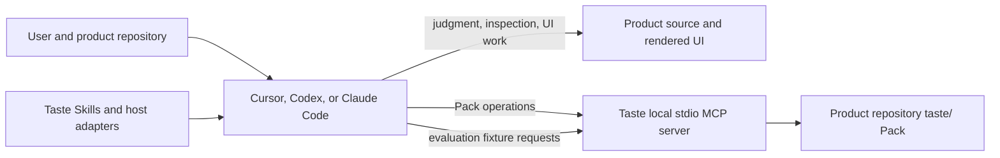

# Engineering guide

This document describes the implementation in this repository. Product intent is in the [product brief](prd.md). Taste is a plugin and local MCP server; it does not host the coding agent or perform repository-wide inspection on its own.

## Architecture



The **host** owns the model, conversation, repository context, browser or computer access, delegation, implementation, checks, and self-review. Taste provides **Skills** that guide host behavior and an **MCP server** for bounded Pack and evaluation operations. The **Pack** is product-specific Markdown and JSON stored at `<product-repository>/taste/`.

Taste does not automatically inspect the UI, read conversation history, run product checks, browse the product, or judge whether a user comment is reusable. Skills direct the host to do those things with available repository and harness tools. The host then passes evidence and Pack content to MCP tools.

## Task routing and learning

The host routes from the user's request and affected product surface:

- Apply relevant product guidance for established behavior (Conformance).
- Explore a new direction, unsupported surface, or correction (Expression), while retaining any applicable guidance.
- Ask a focused question when a material intent or scope choice cannot be resolved from the repository and conversation.

These are behavior labels, not persisted Pack modes. Taste has no persisted task-routing state.

During normal UI work, a clear reusable correction can become a piece of scoped guidance after the host applies it and keeps the edit only when existing checks show improvement or no regression. If the surface has no Pack yet, the host may initialize the minimal scaffold, replace starter content with evidence-backed surface guidance, and mark only that surface `usable_partial`. This does not start a broad sweep. One-off reactions and unresolved alternatives remain task-local. Preserve evidence; add rationale or rejected options when they help retain knowledge that the product itself does not expose. There is no separate approval or promotion step for this path.

For non-trivial UI edits, Skills tell the host to write a task-local brief first (intent, applicable Pack constraints, rejected options), then implement. Check-and-repair is a host protocol: run the product's existing checks and the relevant Pack checklist on the before and after states, and keep the edit only when the checker shows improvement or no regression. Taste does not run those checks, ship a CI runner, or add a tool that computes the delta. When `TASTE_TRACE_DIR` is set, the host may record the two summaries on `taste_session_record` as `checkSummaries`.

Explicit `/taste-setup` or invocation of the `taste-setup` Skill is the broader repository workflow. The host inventories the repository before choosing scope, inspects a bounded selection of rendered UI and source as available, and creates or selectively refreshes guidance. The host distinguishes evidence types, records coverage and inaccessible areas, separates reusable guidance from audit findings and operational notes, self-checks its work, validates, and reports limits. Required `not_inspected` entries record attempts or explain why attempting access was unsafe or outside confirmed scope. Taste supplies the workflow and file tools; it does not perform the sweep itself.

## Pack structure and lifecycle

There is one Pack per product repository. It preserves durable product judgment: decisions and their reasons, tested lessons, and traps discovered through use that future work is unlikely to recover by rereading code or reopening the screen. Packs link to canonical code, lint, docs, instructions, and rendered behavior instead of copying them, and distinguish observation, inference, and settled intent. Their contents are product-specific; Taste does not impose universal reference categories. A typical Pack has a `manifest.json`, README, and product-design entry Skill, plus only the references, checklists, metadata, examples, or evaluation fixtures that the product needs.

The manifest tracks setup readiness separately from coverage. Current statuses are:

- `in_progress`: setup is unfinished; guidance is not generally usable.
- `usable_partial`: one or more explicitly recorded surfaces have sufficient guidance; apply only to those covered surfaces.
- `complete`: the confirmed setup scope and its required coverage target have been met and validation passes.

Coverage entries identify representative app/surface/journeys selected for the setup scope, status, typed evidence with a checked date, and retained guidance files supported by that evidence. The manifest is not a route-by-route inspection log. A Pack can therefore be usable for one surface while other surfaces remain blocked or uninspected. Source-only guidance may satisfy the default `source_reviewed` policy if it is actionable and clearly says visual behavior is unverified. A repository can configure `rendered_flow` when a rendered representative journey is required before a surface is usable. The manifest stays limited to lifecycle fields: name, version, surfaces, setup status, policy, scope, and coverage.

Initialization creates a non-overwriting shell. It is not a completed Pack. The host must replace generic starter text with product-specific guidance before reporting usability. Refresh should inspect existing content first and preserve supported material. Interrupted setup must retain files and an accurate incomplete status so the host can resume.

## MCP server

`src/server.ts` creates the MCP server and registers tools. `src/core/pack.ts` owns Pack path safety, file operations, manifest parsing, lifecycle inspection, validation, and evaluation fixture access. `src/core/diagnostics.ts` emits opt-in operational diagnostics. `src/core/session-trace.ts` writes opt-in local session snapshots when `TASTE_TRACE_DIR` is set, including optional before/after check summaries.

Current tool groups:

| Group | Tools | Role |
| --- | --- | --- |
| Pack operations | `taste_pack_initialize`, `taste_pack_inspect`, `taste_pack_read`, `taste_pack_write`, `taste_pack_validate` | Create a non-overwriting shell; inspect status; read/write Pack files; validate structure and evidence metadata. |
| Session traces | `taste_session_record` | Optional, when `TASTE_TRACE_DIR` is set. The host records a bounded decision snapshot outside the Pack, including optional before/after check summaries. Taste does not run product checks. |
| Evaluation fixtures | `taste_eval_list_fixtures`, `taste_eval_get_generator_case`, `taste_eval_get_judge_packet` | Provide fixture inputs and a separate judge packet. The host runs generator and judge work; packet separation is workflow guidance, not an access-control boundary. |

All Pack file paths are resolved within the target `taste/` directory. The server does not write product UI, harness instructions, or host configuration. Pack validation checks structure and declared evidence relationships. On `usable_partial` and `complete` Packs, coverage whose only evidence type is `inference` fails validation. Validation does not impose a prose template, judge the quality of product design, or verify the truth of host-reported observations.

## Skills and packaging

The repository's `skills/` directory contains seven workflow Skills:

- `taste-design`: entry routing for UI work.
- `taste-conformance`: applying established Pack guidance.
- `taste-expression`: new directions, gaps, and corrections.
- `taste-setup`: explicit repository setup or refresh.
- `taste-sweep`: bounded product inspection during setup.
- `taste-pack`: Pack inspection, validation, and maintenance.
- `taste-evaluate`: evaluation and calibration workflow.

Root plugin metadata and harness-specific adapter files expose the same Skills and bundled server to supported hosts. Cursor has a slash command for setup. Adapters are packaging, not separate implementations. Consult the manifests and [plugin development guide](plugin-development.md) for exact host configuration; host formats can change.

## Evaluation and evidence

The evaluation tools separate fixture generation inputs from expected results and the judge packet. They help the host compare outputs with and without guidance and score criteria independently. Taste does not run the model calls or supply an authoritative judge. A synthetic one-task run is recorded in [validation results](validation-results.md); it found a guidance-induced mismatch and does not establish product-level improvement.

The memory policy is informed by Anthropic's [components of agent memory](https://www.anthropic.com/research/components-of-agent-memory): keep injected context small, avoid storing state that can be reread from the environment, preserve tested lessons with their provenance, and organize deeper notes so they can be retrieved when useful. This does not mean “store only failures” or impose a fixed Pack taxonomy; richer linked guidance can earn its place when it helps future work combine judgment that is otherwise scattered across sources. Other design rationale draws on focused on-demand Skills from [Anthropic](https://claude.com/resources/articles/improving-frontend-design-through-skills), task/surface routing and repository-owned guidance from [Vercel](https://vercel.com/blog/teaching-agents-product-design-at-vercel), knowledge and evaluation patterns from [LangChain](https://www.langchain.com/blog/design-agent), and scenario-specific design rules with rationale from [Emil Kowalski](https://emilkowal.ski/ui/agents-with-taste). These are implementation references and case studies, not controlled evidence that Taste works. Taste-specific statuses, manifest fields, MCP tools, and host self-review are product choices that require evaluation.

## Development

Node.js 20 or later is required. Install dependencies with `npm ci`. Common checks:

```sh
npm run build
npm run typecheck
npm test
npm run validate:package
```

The build commits `dist/server.js` for plugin installs. `npm test` rebuilds it and runs the automated test suite. See [Contributing](../CONTRIBUTING.md) for the contributor workflow.
