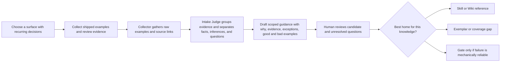
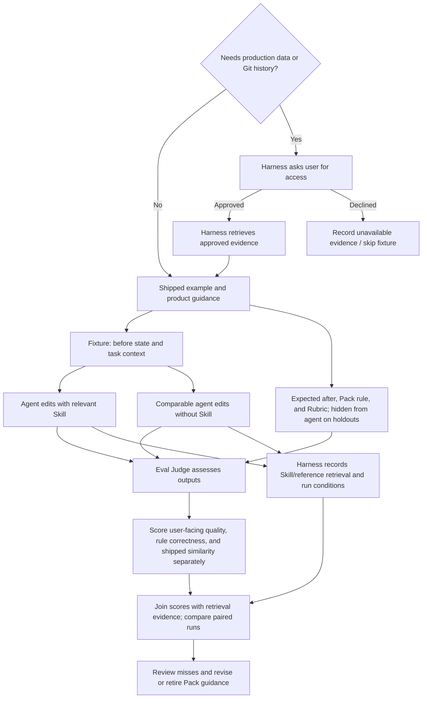
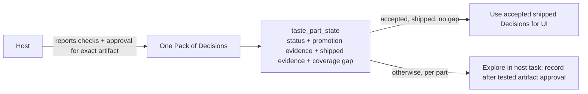

# Engineering

**Draft · Oct 30, 2026 IST**

## Purpose and status

This document describes a possible system design for Taste: its responsibility, major components, and how they might work together. It is not an implementation plan or a locked architecture. Keep the product direction clear while allowing the system shape to change as Taste is used.

Taste's ambition remains the one in the [PRD](prd.md): extract the taste in a shipped product so a coding harness, given a PRD and the Taste Pack, can produce a first pass the user would merge. The ambition is the destination, not a requirement to settle every architectural question now.

The [Google Doc one-pager](https://docs.google.com/document/d/1_Gynsn9Q_s66jlS0YJNDlGG2jxNq-XPfvuhUenPU35U/edit) is retained as a reference and has not been updated for the Nov 1 workflow decisions. Align this document with the current local [PRD](prd.md) and implementation; reconcile or remove the external document later.

This repository contains the Taste plugin implementation and documentation. Example product Packs live under `examples/`; real Packs live in their target repositories.

## Product boundaries and direction

### Current promotion flow (Nov 1 update)

The host harness owns implementation, checks, readiness, user review, and push. Early feedback, rejected drafts, and unresolved gaps remain in the host's active task context. When the user likes an early direction, Taste's skill nudges the host to continue its own workflow; this is not approval of final Pack guidance. `taste_record_signal` records a Decision only after the host reports checks passed and user approval of the exact tested artifact and Decision. Taste stores those claims as evidence; it does not run checks or observe host events. Conformance also requires shipped evidence and no coverage gap. The optional `decisionPromotionCheckpoint` manifest field is plain-language reminder text for the host, with timing determined by that host's workflow. Learning from interaction history beyond the approved artifact is a later experiment (issue #7).

Taste is a plugin for existing coding harnesses (Cursor, Codex, Claude Code). It supplies Skills and MCP tools. It does not run a daemon, and this milestone does not add a hard CI gate. The Pack lives in the product repository at `taste/`, not in this plugin repository.

- A **Pack** carries one product's design judgment. Conformance and Expression are activities over that Pack, not two trees and not two products.
- **Expression is the learner.** One Expression skill interviews and explores requirements; early feedback and drafts remain in the host task. A Decision is recorded only at the tested-artifact approval checkpoint.
- **Conformance** means using a Decision with matching host-reported validation and user-approval evidence, shipped evidence, and no coverage gap, when the user asks for UI.
- The **coding harness** owns the agent loop, planning, models, tools, and PR workflow.

Taste does not configure or run an agent. Taste is not a component library or design-system product. Product-specific design judgment belongs to the product, not OpenSignal.

Locked ∞ rules, from the product one-pager:

1. From scratch → Expression.
2. Defined, agreed, and shipped → Conformance. Same Pack, same artefacts.
3. When the artefacts cannot justify the next step → Expression for that part.
4. Otherwise Conformance.
5. The Pack never flips as a whole. Parts update.

Per-part activity is derived from Decision `status`, matching promotion evidence, shipped evidence, and `coverage_gap`. There is no authored mode field. `supportedModes` on older manifests is deprecated and is not product truth. When the user likes an early direction, the skill nudges the host to continue its own workflow; the host owns checks and review. Pack state selects Expression for a part, and an explicit user ask for new taste, a correction, or greenfield judgment routes into Expression as well.

HelloAlly's ally-platform and omnipresent remain the one-pager's dogfood notes. They are not a blocker. The milestone succeeds when a harness runs setup, Sweep or Expression, UI-with-Pack, and a correction on any product repo.

Shipped work is evidence of what a product does. It is not automatically a rule worth repeating: known flaws should be recorded so similarity to shipped code is not mistaken for quality. A stated preference that conflicts with the shipped product does not become an accepted conformance rule. The user's explicit goal for the current task remains the immediate authority.

## System at a glance


This is the high-level architecture proposed from the linked proof-of-concepts, not a deployment diagram. [LangChain's Content Studio](https://www.langchain.com/blog/design-agent) provides the knowledge-layer starting point—Skills, Wiki, Gates, and Memory—and [Anthropic's article](https://claude.com/resources/articles/improving-frontend-design-through-skills) supports loading focused Skills on demand. [Vercel's product-design system](https://vercel.com/blog/teaching-agents-product-design-at-vercel) grounds the target-repository Pack, conformance guidance, Gates, evidence review, and evaluation. Taste adapts these ideas as a plugin for existing harnesses; it does not adopt LangChain's Slack agent, sandbox, media tools, or runtime.

The architecture separates knowledge and work by responsibility, not necessarily by process or service. The PRD includes an MCP server as part of Taste; MCP exposes Pack and check capabilities to the harness but does not orchestrate work. Its precise tool surface and deployment remain open. The existing harness coding agent performs evidence interpretation, Pack maintenance, implementation, and critique using Taste Skills and tools. Taste does not configure or host those agent roles. Deterministic code is reserved for locating/loading known content and mechanical rules that are reliable without product judgment.

The diagram makes an important distinction: Sweep, implementation, and Critique use the coding agent's judgment; the Eval Judge uses the harness's higher-capacity subagent for the evaluation pass; Gates execute mechanical checks; the Pack carries the context they need. The harness owns any delegation; Taste provides the instructions, data, and tools.

## Pack knowledge layers

The Pack is product-specific knowledge versioned with the target repository under `taste/`. A configured harness loads it from there instead of rebuilding product taste after each clone. LangChain and Anthropic inform the knowledge layers; Vercel's `product-design` work informs the starter content and authoring workflow. Use the useful roles from those sources without copying every folder they used.

| Layer | What it carries | How it is used |
| --- | --- | --- |
| Router and Skills | A bounded entry point routes by task/surface to focused, job-scoped Skills. Skills explain what to do and why, including product judgment, exceptions, and when they apply. | The coding agent uses the relevant Skill as reasoning context. Routing may be expressed in a Skill for the model to follow; it is not assumed to be a deterministic rules engine. |
| Wiki and references | Canonical product facts and shared context, linked from Skills rather than duplicated. | The agent reads only relevant context for its current task. Product-owned sources remain canonical where they exist. |
| Examples and open gaps | Shipped examples, known flaws, and missing or weak evidence. Keep them beside the relevant rule or surface while the collection is small. | The agent and reviewer ground judgments in concrete product work and see where evidence is thin. |
| Gates | Code checks for narrow, measurable rules that can be enforced reliably. | Deterministic feedback handles mechanical failures; product-context decisions stay with the agent and review. |
| Evaluation material | Before/after examples, unseen holdouts, and rubrics that describe what a good result means. | The agent's application of guidance can be judged separately from whether guidance was loaded or whether output resembles shipped work. |

This uses LangChain's Skills, Wiki, and Gates as Pack knowledge roles, with Vercel's examples, evidence review, and eval method for conformance. LangChain's Memory function informs how corrections are captured, but transient memory belongs in the configured harness/plugin store, not in the portable Pack. These are useful responsibilities, not a requirement to give each one a separate directory.

### Pack entry and routing

The Pack needs a discoverable entry point in the target repo so a coding agent knows when product-design guidance applies. A root `AGENTS.md` can provide a thin trigger for harnesses that read it; it is not Taste itself and is not a universal installation mechanism. Harnesses that do not read `AGENTS.md` need their own adapter or setup. Vercel's example uses repository instructions to trigger an in-repo product-design Skill; its Skill then resolves the task mode and routes to focused references. LangChain's Router is also a Skill with a table mapping job types to specialist Skills. Anthropic describes Skills that the model can autonomously identify and load when the task calls for them.

For Taste, these are model-facing instructions and references. Keep the always-loaded entry small; load Decisions as the task requires. The coding agent reads the Pack and `taste_part_state`. That tool derives Conformance or Expression from Decision fields. It does not classify raw language. The user's ask for new taste still routes into Expression for that part.

### One Pack

Use Vercel's `product-design` work as the content and workflow baseline: a bounded trigger, an entry Skill, product references, examples, mechanical Gates, and evals. Store the Pack in `taste/` at the product repository root so it is versioned with the product. Do not reproduce every Vercel folder.

New Packs use one shared tree. Conformance and Expression are not directories. A Decision file records accepted status, trigger, scope, matching artifact references, host-reported validation and approval evidence, shipped evidence, and `coverage_gap`. Activity is derived:

- **Conformance** when status is `accepted`, matching validation and user-approval evidence are present, shipped evidence is present, and `coverage_gap` is false.
- **Expression** otherwise, including an empty Pack (`no_decisions`).

`taste_pack_initialize` writes this tree and does not write `supportedModes`. Packs that still have `references/conformance/` and `references/expression/` validate as a legacy layout. New signals go to `references/decisions/` via `taste_record_signal`. The example under `examples/product-pack/` is a legacy layout kept so older fixtures load.

```text
target-product-repository/
├── AGENTS.md                         # optional thin setup and UI trigger
└── taste/
    ├── README.md
    ├── manifest.json                 # product, revision, surfaces. No mode field.
    ├── skills/
    │   └── product-design/
    │       ├── SKILL.md
    │       └── references/
    │           ├── shared/
    │           │   └── product-facts.md
    │           └── decisions/
    │               ├── README.md
    │               └── {decision-id}.md
    ├── metadata/
    │   └── authority.md
    └── evals/
        ├── rubric.md
        └── fixtures/                 # eval lanes are storage, not Pack modes
```

Put rationale, shipped evidence, known flaws, and coverage-gap notes on the Decision. Eval tools still accept a fixture lane named `conformance` or `expression` under `evals/<lane>/fixtures/`. That lane is not an authored Pack mode.

`manifest.json` names the product, version, and surfaces. It does not declare a mode. `supportedModes`, if still present on an older Pack, is ignored as product truth. Metadata docs describe source authority; they do not duplicate Decisions. Keep the root `AGENTS.md` small. Where the harness reads it, it can tell the coding agent to use Taste for UI work and, if Taste is not installed, to install this plugin. This file is only a discovery hint.

The portable Agent Plugins package is the canonical distribution for clients that support that format. Claude Code uses its native `.claude-plugin/plugin.json` and `.mcp.json` compatibility files while sharing the same Skills and server. The repository is the initial install source; a public marketplace URL and release policy can be selected later. After setup, the plugin reads the repository's existing `taste/` Pack, so a clone reuses product knowledge instead of creating a new Pack. Harness-specific plugin loaders point at that same Pack without copying it into provider-specific skill directories.

The eventual repository hint can be as small as:

```markdown
For product UI work, use the Taste plugin with this repository's `taste/` Pack.
If Taste is not installed in your harness, ask it to install this repository's
Agent Plugins package (or its supported Claude Code compatibility package), then
load the existing Pack.
Read the product-design entry Skill, call taste_part_state, and load the Decisions
for this task. Use Expression when the part has no accepted shipped Decision,
when the artefacts cannot justify the next step, or when I ask for new taste.
```

This is illustrative guidance, not a universal `AGENTS.md` contract. Each harness needs a supported way to install/register Taste and expose its Skills or tools; the adapter should use that harness's mechanism.

The target repository's existing linter owns Gate implementation; `taste/` explains which product rule a Gate supports. Do not create a Taste-specific component library or replace the target's design system.

The entry Skill can follow Vercel's task shapes — Shape, Implement, Review, Copy, and Harden — so the coding agent respects scope. Those names are task shapes, not Taste modes. Conformance and Expression are derived part activities, not folders the Skill switches between. These shapes are optional, not a required workflow.

- **Shape:** use agent reasoning to frame the user, job, flow, states, alternatives, and acceptance signals before implementation.
- **Implement:** apply the requested direction with the smallest coherent product change; resolve meaningful product questions with the user or source evidence.
- **Review:** inspect source and rendered evidence, report findings, and do not edit unless asked.
- **Copy:** improve product language and only the UI structure required to support it; route broader design concerns separately.
- **Harden:** preserve the settled design while finding state, accessibility, responsive, resilience, and recovery issues.

The repository-level trigger tells the coding agent when the UI Skill applies and what it excludes. The Skill entry provides scope, modes, and routing; focused references carry the actual product decisions. This prevents the trigger and every unrelated task from loading the whole knowledge base.

For the first surface, Sweep and the coding agent should gather shipped examples and review evidence, identify repeated decisions, then draft guidance in the narrowest relevant reference. Each candidate should make the decision observable and include why it matters, scope, evidence, exceptions, and useful good/bad examples. Keep candidate decisions pending human review. Put known defects next to the example or rule they qualify so the agent learns the intended pattern without reproducing the defect.

A Sweep is not complete from source code alone. The coding agent should use the harness's available browser or computer-use tools to open the running product, traverse the chosen flow, inspect visible and interactive states, and capture screenshots. Record the page or URL, flow step, state, date, viewport, screenshot path, and what the evidence supports. Correlate this with code, Git history, reviews, and product-owned sources. If access or visual tools are unavailable, ask the harness/user for access or captures and mark the evidence incomplete.

### Workflow Skills and commands

Taste defines explicit, user-invokable workflow Skills and one automatically relevant UI entry Skill. In the portable package, Skills are the shared command definitions; harnesses expose them through their own skill picker/invocation syntax. Do not duplicate the workflow body into provider-specific command files unless a harness adapter specifically requires an alias.

| Skill | Trigger | Outcome |
| --- | --- | --- |
| `taste-setup` | User explicitly asks to set up Taste or initialize a Pack | Create or continue one `taste/` Pack. For design work with no Pack, defer creation until the user approves the tested artifact and Decision. |
| `taste-sweep` | User asks to learn, sweep, or refresh taste from shipped UI | Inspect the live product and keep candidate judgments in the host task until the final promotion checkpoint. |
| `taste-design` | Any UI/UX task | Load an existing Pack. Conformance where Decisions qualify; transient Expression if absent, empty, gapped, or newly requested. Create an absent Pack only after final user approval. |
| `taste-conformance` | User asks to match shipped taste, or part state derives Conformance | Apply accepted Decisions with complete promotion evidence, shipped evidence, and no coverage gap. |
| `taste-expression` | Greenfield, new taste, a gap, or a correction; or part state derives Expression | Interview and explore in the host task; persist only after host checks and user approval of the tested artifact and Decision. |
| `taste-evaluate` | User asks to evaluate guidance or a calibration run is due | Compare with/without-Skill generation and hand judging to the harness. |

Setup does not fabricate Decisions to make a Pack look like Conformance. An empty Pack derives to Expression. That is the from-scratch rule, not a missing mode route.

This creates one entry Skill per product Pack, with focused references organized by job and surface. A reference should contain the product's rule and reasoning, not just generic advice. Add a specialized Skill for a craft (such as copy or animation) when routing by job benefits from it; do not create a separate Skill for every topic by default.

### Runtime path for a UI task

The harness invokes Taste context for relevant UI work, but the coding agent remains the decision-maker. This is a typical path; review and gate steps are conditional on the task and the available Pack.

```mermaid
sequenceDiagram
  actor User
  participant Harness as User's coding harness
  participant Agent as Coding agent
  participant Pack as Taste Pack
  participant Tools as Repo / Git / browser / computer tools
  participant Parts as taste_part_state
  participant Gate as Deterministic Gates

  User->>Harness: UI task and constraints
  Harness->>Agent: Start task in existing agent loop
  Agent->>Pack: Read entry Skill, facts, and Decisions
  Pack-->>Agent: Decisions for the parts this task touches
  Agent->>Parts: Ask derived activity for those parts
  Parts-->>Agent: Conformance or Expression per part, not a pack-wide mode
  Agent->>Tools: Inspect product behavior and source evidence
  Tools-->>Agent: Screenshots, rendered states, code, and product references
  Agent->>Agent: Apply Conformance Decisions; Expression writes gaps and new signals
  Agent->>Tools: Implement scoped product change
  opt Relevant reliable Gate exists
    Agent->>Gate: Check changed code
    Gate-->>Agent: Mechanical findings
    Agent->>Tools: Correct findings when appropriate
  end
  opt Contextual review is useful
    Agent->>Agent: Review against Pack with Critique guidance
    Agent->>Agent: Decide which findings apply and revise
  end
  opt Visual or interaction quality changed
    Agent->>Tools: Render and inspect changed states
    Tools-->>Agent: Rendered evidence
  end
  Agent-->>Harness: Change, verification evidence, remaining questions
  Harness-->>User: Reviewable result
```

The coding agent can ask the user for missing product intent or access through the harness. The diagram does not make Gate, Critique, or rendered review mandatory on every task.

## Components

### Pack

The Pack is the portable product-specific context used by a harness. It can hold observable design judgments, their rationale and evidence, useful examples and known flaws, shared product facts, gaps in what is understood, and guidance for applying that knowledge.

These are useful kinds of information to preserve, not a required record taxonomy or schema. A Pack should make it possible to distinguish an evidence-backed product rule from a general suggestion, identify where a rule applies, and see what remains uncertain.

The first Conformance Pack lives under the target repository's `taste/` directory. Its content follows Vercel's useful pattern—an entry Skill, focused product references, examples, Gates, and evals—while keeping product-owned knowledge together in a harness-neutral location. Adapt the contents to the chosen product and surface; keep the directory structure open to revision if use shows a better fit.

### Discover and extract

A Sweeper-like capability uses agent intelligence to inspect shipped work and available review evidence, then surface candidate judgments across relevant design angles. The first surface should be one where repeated review decisions already exist—the hardest step is choosing that surface. The coding agent should be nudged to document the repeated decision, why it matters, its scope, exceptions, examples, and evidence in the narrowest useful Pack guidance.

Use a three-part intake pattern, adapted from Vercel. The **Collector** gathers raw artifacts and source links without proposing rules. The **Intake Judge** groups related evidence, checks coverage and provenance, and separates verified facts, inferences, and open questions into a review packet. A **human reviewer** decides whether each candidate becomes a Skill/reference, Gate, Exemplar, Eval case, coverage gap, or no change. Keep these as distinct responsibilities even if one model or tool performs more than one step.

Do not infer a universal rule from one screenshot, one file, or one comment. The agent records evidence and uncertainty, and proposes a candidate for review; it does not silently turn a pattern into accepted product policy. The product-specific dogfood begins with the surface named in the PRD. Sweep followed by historical replay is one possible discovery path, not the only one.

This applies Vercel's first-surface method: start where decisions recur in shipped work and reviews, and turn the reasoning behind those decisions into guidance an agent can find. The agent should make that candidate visible when it encounters a repeated judgment missing from the Pack. It can draft the record; product owners review whether it becomes a shared standard.



The destinations are logical roles, not a fixed file tree. Product-context judgment stays in agent-readable guidance; only a narrow, reliable invariant graduates to a Gate. This follows Vercel's distinction between a linter finding a mechanical issue and a Skill explaining a decision that depends on product context.

### Capture and maintain

Expression is that learner. It is not a second module. During exploration, keep candidate signals in the host's active task. After checks pass and the user approves the exact tested artifact and Decision, the host may call `taste_record_signal`:

- `interview` for greenfield and new requirements
- `sweep` when a swept candidate has completed the same promotion checkpoint
- `gap` when the artefacts cannot justify the next step
- `rejected_pass` when the user corrects shipped or generated work

Only accepted, finalized Decisions are persisted by the current tool contract. Reusing the Decision `id` updates that part in place. The rest of the Pack is left alone. Private scratch notes, interim feedback, and rejected drafts stay in harness memory. The host reports validation and approval evidence; Taste does not decide whether those host workflows were sufficient.

### Deliver guidance

Skills are one source-backed way to load job-specific guidance only when relevant. An agent-facing Router can help the model select focused guidance for the current task, while shared product facts can live in a linked reference rather than being copied into every Skill. Taste may use this organization if it works across target repositories and harnesses.

Guidance should be specific enough to help an agent act, without hardcoding details the product has not chosen or falling back on vague praise. Where the product has an existing design system, its established patterns take precedence in conformance work.

This also addresses Anthropic's observation that unguided generation can converge on familiar, generic frontend choices. Load product-specific Skill guidance when it applies, rather than adding frontend rules to every coding request. Keep generic anti-default prompts subordinate to what the product has actually chosen.

LangChain's Content Studio also treats some rules as model-version workarounds: remove or revise them when stronger models no longer need them, while preserving the product principle they were trying to enforce. Pack guidance should remain maintainable rather than accumulating permanent compensating instructions.

### MCP interface

The MCP server exposes Pack reads and writes to the harness. It does not own planning, model selection, generation, Critique, or the task loop. See [Implementation status](#implementation-status) for which tools exist in this repo today. There is no daemon beside the harness's stdio MCP process.

### Agent judgment and deterministic logic

Use the coding agent's intelligence for work that needs meaning or product context: interpreting evidence, noticing patterns, deciding which guidance applies, weighing exceptions and tradeoffs, proposing UI, and reviewing whether the result fits the product. Taste should give the agent evidence and reasons so it can exercise that judgment; it should not try to encode the full design decision tree as application logic.

Keep deterministic code for narrow operations whose inputs and outcomes are explicit: locating a Pack file, writing a Decision from fields the agent already gathered, and deriving part activity from those fields. Derivation is mechanical and is not a keyword classifier:

- accepted + complete matching promotion evidence + shipped evidence + coverage gap false → Conformance for that Decision
- anything else → Expression for that Decision
- no Decisions → Expression (`no_decisions`)
- a scope is Conformance only when every Decision in it is Conformance

`taste_part_state` returns that report. It does not run or observe host checks, user review, or push. The user's early positive reaction prompts the skill to nudge the host to continue its workflow; it does not promote a Decision. `taste_mode_resolve` remains in the server as a deprecated task-local helper from earlier plumbing. It does not read the Pack. Skills should not use it as the ∞ rule. The user's request still routes into Expression when they ask for new taste, a correction, or greenfield judgment, even if another part of the Pack is Conformance.

This is the intended split, not a claim that every implementation needs a Router or a linter. When a check requires judgment, depends on product context, or produces unreliable flags, keep it in agent guidance and review.

### Check and review

Taste can support two complementary kinds of feedback:

- **Gates** for failures code can identify reliably and explain with a concrete fix. False-positive-prone or context-dependent judgments belong in guidance or review instead.
- **Critique** for contextual review of generated work against the Pack, relevant examples, and the user's task. The existing coding agent can run a review pass using the relevant Skill; a harness may delegate to its own subagent feature if available. Taste supplies no separate Critic agent or agent configuration.
- **Intake Judge** for checking and grouping evidence during Pack upkeep; its output is a pending review packet, not a verdict that changes product standards.
- **Eval Judge** for scoring controlled with/without-Skill outputs against an evaluation Rubric. This is a different task and context from Critique: Critique reviews the current implementation; the Eval Judge compares evaluation runs. The harness supplies the judge reasoning, potentially in a separate context or through its own evaluator facility.

Source inspection can establish behavior, but visual and interaction quality require rendered evidence. A review should say what was actually checked and cite the relevant product guidance. Taste does not need to ship a browser to support rendered verification; the harness can use its own tools.

### Evaluate

Evaluation asks whether the Pack and its delivery improve results. Vercel's proof of concept provides a concrete starting method: an agent edits a before state, then a judge checks the result against a Rubric; fixtures come from shipped examples, and holdouts hide expected edits to check generalization. Run comparable fixtures with and without relevant Skill guidance. Score rule correctness separately from similarity to shipped output; a high similarity score is not success when the shipped example has a known flaw.

Each fixture starts from a real shipped example: a task prompt and before state for the generator, the expected after state and relevant Pack guidance, plus a Rubric for the Eval Judge. For a holdout, keep the expected after state out of the generator's context and make it available to the judge. Run the same task with and without the selected Skill; keep the model, repository state, and other harness context the same where practical, and record any differences. The with-Skill run records which Skill and references were actually loaded.

The intended Eval Judge is a higher-capacity model subagent managed by the coding harness, separate in role and context from the generator. Taste supplies the evaluation Skill, Rubric, fixture, and expected result; the harness delegates the judging pass to its configured higher-capacity model and returns the scored assessment. Taste does not host or configure that subagent. The Eval Judge scores each output independently and gives reasons tied to observed evidence. The harness records which Skills and references each generator run loaded; that retrieval evidence is joined with the Judge's scores rather than guessed by the Judge. Compare paired scores after judging. Where practical, hide the with/without arm label from the Judge until its individual scores are recorded. Human review can calibrate the Rubric and adjudicate uncertain results. The exact model and harness delegation mechanism remain open. The user-facing quality dimensions remain anchored to the PRD; rule correctness and similarity to shipped work are separate diagnostic dimensions.

For a practical first evaluation, select several shipped changes from the first surface, retain some as examples the Skill can reference, and reserve held-out cases whose expected edits are hidden from the coding agent. Compare both runs, then review misses to distinguish a retrieval failure, a guidance failure, a task-context problem, or an evaluation problem. A good score informs human Pack review; it does not automatically promote or rewrite product guidance.

The coding agent's harness may need production data or Git history to construct or run a useful fixture. When required, the harness can ask the user for access through its own tools and permissions. Taste records the need; it does not grant access or collect the data independently. Retrieval (did the agent load the guidance?) and application (did it follow the guidance?) are distinct questions and should be observable separately.



The Eval Judge is an agent role, not a deterministic linter. People can review its Rubric and adjudicate uncertain results. Use deterministic checks only for the mechanical rules they can establish. An evaluation run should preserve enough information to tell whether the Skill was retrieved, what evidence was available, and how the output was judged.

Keep the Judge's responsibilities explicit:

- The **Intake Judge** validates sources and coverage and prepares proposed Pack updates from raw evidence.
- The **Eval Judge** sees the output, the Rubric, and the expected result (including holdout answers), then assesses the result. The generator does not see holdout answers.
- Neither Judge owns product policy. A person decides whether Pack guidance changes, and the Eval Judge's scores are evidence rather than automatic approval.

The starting Rubric should track the PRD's mergeable-first-pass goal and its signals: whether the first pass is mergeable, whether it required a long design prompt, and whether the agent needed re-teaching for each screen. The Judge assesses the result and, with the run transcript, whether it appears mergeable without a long prompt or screen-by-screen correction. The harness records `skill_loaded` and other retrieval evidence separately. Keep rule correctness and similarity to shipped work as distinct Judge scores. A Gate pass rate is useful when the relevant Gate exists, but it is not a proxy for overall UI quality.

The PRD's success signals remain central: a mergeable first pass, no long design prompt, and no re-teaching on each screen. The with/without-Skill comparison is the starting method for judging Pack effect; Gate pass rate is supplemental, not a proxy for overall UI quality. What establishes a mergeable first pass without hand-labeling remains an open question.

## Part activity, loops, and lifecycle

Conformance and Expression are activities on parts of one Pack. They share the Pack, the entry Skill, product facts, the harness, critique, and evaluation. A part is Conformance only when its Decisions are accepted, have complete matching host-reported validation and approval evidence, have shipped evidence, and have no coverage gap. Expression explores new direction and corrections; early feedback, rejected drafts, and unresolved gaps stay in the host task until the final tested artifact and Decision are approved.

`taste_part_state` reports the derived activity and does not flip unrelated Decisions. A user liking an early direction nudges the host to continue its workflow. The optional `decisionPromotionCheckpoint` manifest value provides reminder text only; each host's workflow determines timing, and Taste does not monitor it.

### Conformance loop

1. Load the Pack and the Decisions whose derived activity is Conformance.
2. If the part does not qualify, hand that part to Expression. Do not treat prose in a legacy folder as accepted shipped taste.
3. Implement from those Decisions. Shipped UI is evidence, not an instruction to copy a known flaw.
4. Use mechanical checks only where the product already has a reliable rule. Critique stays with the harness agent.
5. A correction does not silently become Conformance. Expression records it with trigger `gap` or `rejected_pass`.

### Expression loop

The host keeps exploration in its task context, then runs its own checks and presents the tested artifact and Decision for user approval. After the user approves both, the host calls `taste_record_signal` with matching artifact references and evidence. Shipped evidence is included only when the host inspected an actually shipped artifact.

A confirmed statement remains Expression until it also has shipped evidence and no coverage gap. A pre-push Decision may be updated with shipped evidence after shipping. The tool stores host-reported evidence strings; it does not define or verify the host's checks, approval, or meaning of shipped.

The [OpenAI frontend article](https://developers.openai.com/blog/designing-delightful-frontends-with-gpt-5-4) and its [`frontend-skill`](https://github.com/openai/skills/tree/main/skills/.curated/frontend-skill) can inform expression-time guidance: distinctive composition, visual references, and avoiding common defaults, while preserving an existing product's visual language. [Emil Kowalski's aspect Skills](https://emilkowal.ski/ui/agents-with-taste) offer examples of capturing the why behind detailed interface guidance. These inform the agent's knowledge, not a Taste rules engine.

### What does not change the Pack



There is no mode switcher. A review packet, human acceptance, and shipped evidence are what the fields record. The open question is who starts that review. Engineering does not answer it here.

An engineering reading, not a product lock: a proposed Decision's candidate Gate is a warning at most. It does not block the harness. Rung-style reuse of adjacent shipped patterns can inform a Sweep proposal; it does not mark a Decision accepted.

## Taste plugin repository

This repository builds a plugin for existing coding harnesses. It packages Skills and tool integrations that the harness's coding agent can use; it does not configure or run an agent. Product-specific Skills and taste knowledge remain in the target repository's `taste/` Pack. A compact starting structure is:

```text
taste-plugin/
├── skills/                  # Taste workflows invoked by the host coding agent
├── src/
│   ├── core/                 # Pack lifecycle, evidence/provenance, review, and eval logic
│   └── tools/                # MCP server and tool interfaces over core operations
├── plugin.json               # Agent Plugins manifest (Codex and Cursor)
├── mcp.json                  # portable stdio server configuration
├── .claude-plugin/
│   └── plugin.json           # Claude Code native manifest
├── .mcp.json                 # Claude Code MCP configuration
├── docs/                    # product, system, and setup documentation
├── examples/
│   └── product-pack/        # legacy split example; new Packs are one decisions tree
└── tests/                   # plugin, tool, Pack, and harness integration checks
```

The plugin Skills tell the host agent when to set up a Pack, sweep, load it for UI, nudge its own workflow after positive early direction, and record finalized signals after host checks and user approval. The product's `taste/skills/product-design/SKILL.md` points at that product's Decisions. `core/` discovers and validates the Pack, writes Decision files, and derives part activity from fields already on those files. It does not decide product meaning, run or observe host workflows, or verify host-reported evidence. Evaluation fixtures and Rubrics belong with the product Pack. The root Agent Plugins package is shared by Codex and Cursor; Claude Code's native manifest and `.mcp.json` point at the same Skills and server. The harness owns higher-capacity subagent delegation for the Eval Judge. This structure is revisable.

## Implementation status

This is v1 plumbing: a local plugin a harness can install and drive. It is not a finished taste system, and the milestones in [implementation-plan.md](implementation-plan.md) are plumbing checkpoints, not product completion. No daemon. No hard CI gate.

### MCP tools in this repo

Implemented:

- `taste_pack_initialize` — one shared Pack under `<product-repo>/taste`. Does not overwrite. Does not write `supportedModes` or split trees.
- `taste_pack_inspect` — layout (`shared`, `legacy-split`, `mixed`, `incomplete`), decision count, validation.
- `taste_pack_read` / `taste_pack_write` — files confined to `taste/`.
- `taste_pack_validate` — shared decisions home, or a legacy pair of conformance and expression READMEs.
- `taste_record_signal` — create or replace one accepted, finalized Decision after host-reported checks and approval evidence. Expression and Sweep may use it at that checkpoint.
- `taste_part_state` — derive Conformance or Expression per Decision. Does not initiate a change.
- `taste_eval_list_fixtures`, `taste_eval_get_generator_case`, `taste_eval_get_judge_packet` — fixture lanes named `conformance` and `expression` are storage paths.
- `taste_mode_resolve` — deprecated task-local helper. Does not read the Pack. Skills should not treat it as the ∞ rule.

Not built, and not claimed:

- A daemon, a hosted agent, or a Critic process of Taste's own.
- Hard CI gates, or a Gate runner inside Taste. The product repo's linter remains the product repo's.
- Automatic observation of host checks, user approval, readiness, or push; the host reports completed validation and approval of the exact artifact and Decision.
- A definition of "shipped" beyond the evidence strings stored on the Decision.
- Detection of "artefacts can't justify" beyond the `coverage_gap` flag the agent sets when it records a gap.
- Ally-specific dogfood, live IDE install proofs, or a with/without-Pack study on real product history. `docs/validation-results.md` is a synthetic smoke run.

`examples/product-pack/` still uses the legacy split folders so existing fixtures load. New Packs from `taste_pack_initialize` do not.

## Design status

The cited sources make a starting architecture concrete. They do not validate Taste as a combined system. The locked product direction is the plugin loop in the PRD: one Pack in the product repo, derived part activity, Expression as the learner. File grouping, MCP tool names, and the Critic arrangement can still change.

## Open system-design questions

Product questions that stay open are listed in [prd.md](prd.md), including what "shipped" means, known flaws versus "shipped wins", the user-facing unit of the ∞, and the from-scratch threshold. The host owns checks, readiness, review, and push; these are outside Taste.

Engineering questions still open:

- Which design angles generalize across products?
- How a sweep tells deliberate patterns from accidents, sharply enough to avoid thrashing.
- Which checks are reliable enough to be mechanical, once hard gates are in scope.
- What evidence makes evaluation trustworthy without extensive hand-labeling.

The Pack location is the product repository's `taste/` directory.

## References

- Product direction: [Taste: One-Pager](https://docs.google.com/document/d/1_Gynsn9Q_s66jlS0YJNDlGG2jxNq-XPfvuhUenPU35U/edit), mirrored in [docs/prd.md](prd.md).
- LangChain: [Building a design agent](https://www.langchain.com/blog/design-agent) and [design-agent repository](https://github.com/langchain-ai/design-agent).
- Anthropic: [Improving frontend design through Skills](https://claude.com/resources/articles/improving-frontend-design-through-skills).
- Vercel: [Teaching agents product design at Vercel](https://vercel.com/blog/teaching-agents-product-design-at-vercel).
- OpenAI: [Designing delightful frontends with GPT-5.4](https://developers.openai.com/blog/designing-delightful-frontends-with-gpt-5-4) and [frontend-skill](https://github.com/openai/skills/tree/main/skills/.curated/frontend-skill).
- Emil Kowalski: [Agents with Taste](https://emilkowal.ski/ui/agents-with-taste).
