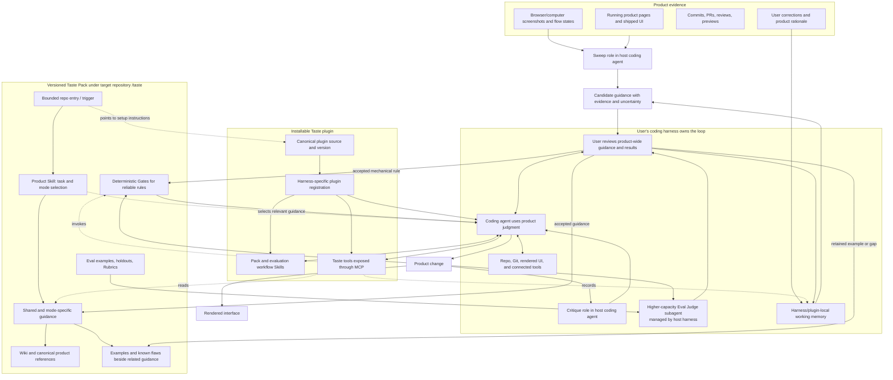
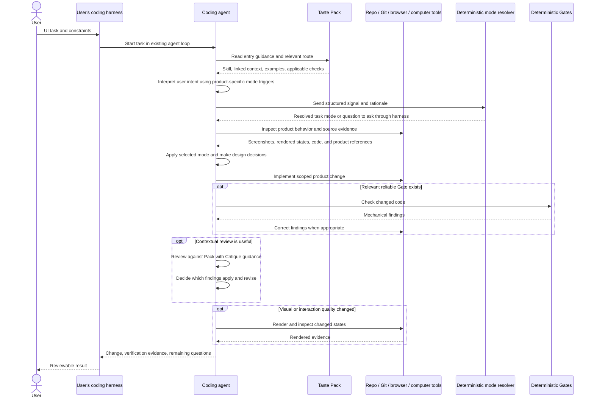
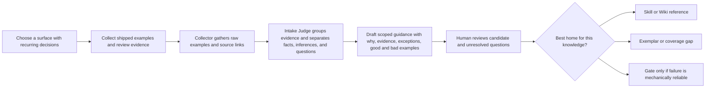
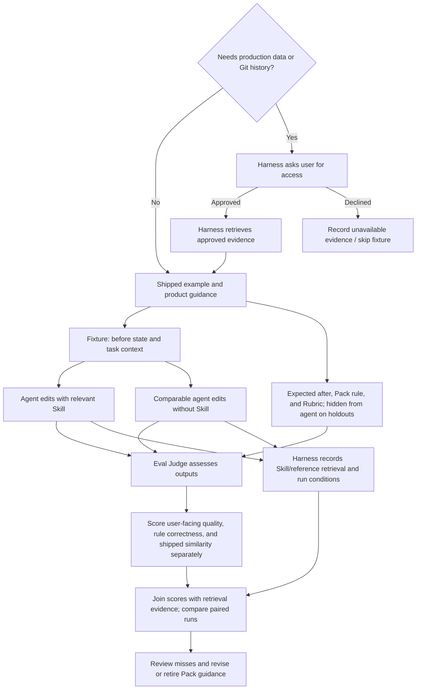
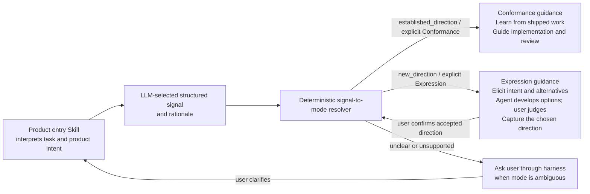

# Engineering

**Draft · Oct 30, 2026 IST**

## Purpose and status

This document describes a possible system design for Taste: its responsibility, major components, and how they might work together. It is not an implementation plan or a locked architecture. Keep the product direction clear while allowing the system shape to change as Taste is used.

Taste's ambition remains the one in the [PRD](prd.md): extract the taste in a shipped product so a coding harness, given a PRD and the Taste Pack, can produce a first pass the user would merge. The ambition is the destination, not a requirement to settle every architectural question now.

The [Google Doc one-pager](https://docs.google.com/document/d/1_Gynsn9Q_s66jlS0YJNDlGG2jxNq-XPfvuhUenPU35U/edit) is the product source of truth; [docs/prd.md](prd.md) mirrors it. If this document and the Doc disagree about the product, the Doc wins.

This repository contains the Taste plugin implementation and documentation. Example product Packs live under `examples/`; real Packs live in their target repositories.

## Product boundaries and direction

Taste is a plugin for existing coding harnesses that supplies a portable, product-specific design-taste layer. Its proposed system includes:

- A **Pack** that carries product-specific design knowledge into a target product repository.
- **Capabilities** that help discover, capture, deliver, and check that knowledge.
- A connection to the user's **coding harness**, which owns the agent loop, planning, models, tools, and PR workflow.

Taste supplies Skills, tools, and checks that the harness's existing coding agent can use. Taste does not configure or run an agent; the harness owns the agent, model, loop, and any delegation. Taste is not a component library or design-system product. Product-specific design judgment belongs to the product, not OpenSignal.

Conformance comes first:

- **Conformance** means matching the judgment a product has already shipped across design angles such as style, typography, themes and tokens, UX, interaction, flow, and copy. The angle set stays open.
- **Expression** means inventing or extending taste. Its dogfood sequence is later, on omnipresent, but the shared Pack and harness architecture should support it from the outset.

For now, HelloAlly's ally-platform is the conformance dogfood surface, with flow and interaction as the first pain to address. This is sequencing for dogfooding, not a product-specific architecture. Product thinking remains harness- and product-agnostic.

Shipped work is evidence of what a product does. It is not automatically a rule worth repeating: known flaws should be recorded so similarity to shipped code is not mistaken for quality. A stated preference that conflicts with the shipped product does not become an accepted conformance rule. The user's explicit goal for the current task remains the immediate authority.

## System at a glance



This is the high-level architecture proposed from the linked proof-of-concepts, not a deployment diagram. [LangChain's Content Studio](https://www.langchain.com/blog/design-agent) provides the knowledge-layer starting point—Skills, Wiki, Gates, and Memory—and [Anthropic's article](https://claude.com/resources/articles/improving-frontend-design-through-skills) supports loading focused Skills on demand. [Vercel's product-design system](https://vercel.com/blog/teaching-agents-product-design-at-vercel) grounds the target-repository Pack, conformance guidance, Gates, evidence review, and evaluation. Taste adapts these ideas as a plugin for existing harnesses; it does not adopt LangChain's Slack agent, sandbox, media tools, or runtime.

The architecture separates knowledge and work by responsibility, not necessarily by process or service. The PRD includes an MCP server as part of Taste; MCP exposes Pack and check capabilities to the harness but does not orchestrate work. Its precise tool surface and deployment remain open. The existing harness coding agent performs evidence interpretation, Pack maintenance, implementation, and critique using Taste Skills and tools. Taste does not configure or host those agent roles. Deterministic code is reserved for locating/loading known content and mechanical rules that are reliable without product judgment.

The diagram makes an important distinction: Sweep, implementation, and Critique use the coding agent's judgment; the Eval Judge uses the harness's higher-capacity subagent for the evaluation pass; Gates execute mechanical checks; the Pack carries the context they need. The harness owns any delegation; Taste provides the instructions, data, and tools.

## Pack knowledge layers

The Pack is product-specific knowledge versioned with the target repository under `taste/`. A configured harness loads it from there instead of rebuilding product taste after each clone. LangChain and Anthropic inform the knowledge layers; Vercel's `product-design` work informs the starter content and authoring workflow. Use the useful roles from those sources without copying every folder they used.

| Layer | What it carries | How it is used |
| --- | --- | --- |
| Router and Skills | A bounded entry point routes by task/surface to focused, job-scoped Skills. Skills explain what to do and why, including product judgment, exceptions, and when they apply. | The coding agent uses the relevant Skill as reasoning context. Routing may be expressed in a Skill for the model to follow; it is not assumed to be a deterministic rules engine. |
| Wiki and references | Canonical product facts and shared context, linked from Skills rather than duplicated. | The agent reads only relevant context for its current task. Product-owned sources remain canonical where they exist. |
| Examples and open gaps | Shipped examples, known flaws, and missing or weak evidence. Keep them beside the relevant rule or surface while the collection is small. | The agent and reviewer ground judgments in concrete product work and see where evidence is thin. |
| Gates | Code checks for narrow, measurable rules that can be enforced reliably. | Deterministic feedback handles mechanical failures; product-context decisions stay with the agent and review. |
| Evaluation material | Before/after examples, unseen holdouts, and rubrics that describe what a good result means. | The agent's application of guidance can be judged separately from whether guidance was loaded or whether output resembles shipped work. |

This uses LangChain's Skills, Wiki, and Gates as Pack knowledge roles, with Vercel's examples, evidence review, and eval method for conformance. LangChain's Memory function informs how corrections are captured, but transient memory belongs in the configured harness/plugin store, not in the portable Pack. These are useful responsibilities, not a requirement to give each one a separate directory.

### Pack entry and routing

The Pack needs a discoverable entry point in the target repo so a coding agent knows when product-design guidance applies. A root `AGENTS.md` can provide a thin trigger for harnesses that read it; it is not Taste itself and is not a universal installation mechanism. Harnesses that do not read `AGENTS.md` need their own adapter or setup. Vercel's example uses repository instructions to trigger an in-repo product-design Skill; its Skill then resolves the task mode and routes to focused references. LangChain's Router is also a Skill with a table mapping job types to specialist Skills. Anthropic describes Skills that the model can autonomously identify and load when the task calls for them.

For Taste, these are model-facing instructions and references. Keep the always-loaded entry small; load deeper guidance as the task requires. The coding agent interprets the request using the product's mode triggers, then passes a structured signal to a small deterministic resolver. The resolver maps explicit signals to Conformance, Expression, or a question; it does not classify raw language or invent product meaning.

### Shared Pack structure for both modes

Use Vercel's `product-design` work as the content and workflow baseline: a bounded trigger, an entry Skill that selects task and mode and routes to focused guidance, product references, examples, mechanical Gates, and evals. The Pack structure supports Conformance and Expression from the start, even if dogfooding or particular experiments begin with one mode. They share the repository Pack, entry Skill, product facts, harness integration, and relevant capabilities; each mode has its own evidence, guidance, and evaluation cases where needed. Store the portable Pack in a dedicated `taste/` directory at the target repository root so it is versioned with the product and can be found after a clone. Do not reproduce every Vercel folder just because it appears in their example tree.

```text
target-product-repository/
├── AGENTS.md                         # optional thin setup and UI trigger
└── taste/
    ├── README.md                     # Pack contents, canonical setup source, and how a harness loads it
    ├── manifest.json                # product, supported modes, Pack revision, and ownership
    ├── skills/
    │   └── product-design/
    │       ├── SKILL.md              # shared entry, mode-selection policy, task routing
    │       └── references/
    │           ├── shared/
    │           │   └── product-facts.md
    │           ├── conformance/
    │           │   └── surface-{surface}.md
    │           └── expression/
    │               └── direction-{topic}.md
    ├── metadata/
    │   ├── authority.md              # canonical product sources and precedence
    │   └── sources.md                # evidence index, if useful at this scale
    └── evals/
        ├── rubric.md                 # shared Judge dimensions and scoring guidance
        ├── conformance/
        │   └── fixtures/{fixture}/{before,after}
        └── expression/
            └── fixtures/{fixture}/{before,after}
```

This is a small starting shape, not a required set of folders. Shared guidance holds facts that apply in both modes. Conformance references capture decisions inferred from shipped work, with examples and known flaws; Expression references capture intended new direction, rationale, alternatives, and the user's choices. An item may be shared or mode-specific according to its meaning. Put an example, rationale, and any known flaw beside the relevant guidance. Keep missing-evidence notes beside the affected reference too. Add a shared sources or coverage index only when inline notes become difficult to navigate; create a separate Exemplar collection only when the number or reuse of examples warrants it. Keep copy, resilience, terminology, and interface-quality guidance in the surface reference until a distinct Skill or shared reference makes routing clearer.

The `manifest.json` and metadata docs describe the Pack, supported modes, and source authority; they do not duplicate the actual product guidance. Keep the root `AGENTS.md` small. Where the harness reads it, it can tell the coding agent to use Taste for relevant work and, if Taste is not available, to ask the harness to install or configure it using the canonical source recorded in `taste/README.md`. It may also link to the entry Skill. This file is only a discovery hint: actual installation and tool/Skill registration belong to the harness or its Taste adapter.

The portable Agent Plugins package is the canonical distribution for clients that support that format. Claude Code uses its native `.claude-plugin/plugin.json` and `.mcp.json` compatibility files while sharing the same Skills and server. The repository is the initial install source; a public marketplace URL and release policy can be selected later. After setup, the plugin reads the repository's existing `taste/` Pack, so a clone reuses product knowledge instead of creating a new Pack. Harness-specific plugin loaders point at that same Pack without copying it into provider-specific skill directories.

The eventual repository hint can be as small as:

```markdown
For product UI work, use the Taste plugin with this repository's `taste/` Pack.
If Taste is not installed in your harness, ask it to install this repository's
Agent Plugins package (or its supported Claude Code compatibility package), then
load the existing Pack.
Read the product-design entry Skill and follow its instructions to choose Conformance,
Expression, or ask me to clarify the intended mode.
```

This is illustrative guidance, not a universal `AGENTS.md` contract. Each harness needs a supported way to install/register Taste and expose its Skills or tools; the adapter should use that harness's mechanism.

The target repository's existing linter owns Gate implementation; `taste/` explains which product rule a Gate supports. Do not create a Taste-specific component library or replace the target's design system.

The `SKILL.md` entry can follow Vercel's request modes—Shape, Implement, Review, Copy, and Harden—so the coding agent respects task intent and scope. These task modes are separate from Taste's Conformance and Expression modes. The product Skill defines how the coding agent recognizes each Taste mode and routes to its task-specific and mode-specific guidance. These are starting modes and names, not a requirement that each task follow a rigid workflow.

- **Shape:** use agent reasoning to frame the user, job, flow, states, alternatives, and acceptance signals before implementation.
- **Implement:** apply the requested direction with the smallest coherent product change; resolve meaningful product questions with the user or source evidence.
- **Review:** inspect source and rendered evidence, report findings, and do not edit unless asked.
- **Copy:** improve product language and only the UI structure required to support it; route broader design concerns separately.
- **Harden:** preserve the settled design while finding state, accessibility, responsive, resilience, and recovery issues.

The repository-level trigger tells the coding agent when the UI Skill applies and what it excludes. The Skill entry provides scope, modes, and routing; focused references carry the actual product decisions. This prevents the trigger and every unrelated task from loading the whole knowledge base.

For the first surface, Sweep and the coding agent should gather shipped examples and review evidence, identify repeated decisions, then draft guidance in the narrowest relevant reference. Each candidate should make the decision observable and include why it matters, scope, evidence, exceptions, and useful good/bad examples. Keep candidate decisions pending human review. Put known defects next to the example or rule they qualify so the agent learns the intended pattern without reproducing the defect.

A Sweep is not complete from source code alone. The coding agent should use the harness's available browser or computer-use tools to open the running product, traverse the chosen flow, inspect visible and interactive states, and capture screenshots. Record the page or URL, flow step, state, date, viewport, screenshot path, and what the evidence supports. Correlate this with code, Git history, reviews, and product-owned sources. If access or visual tools are unavailable, ask the harness/user for access or captures and mark the evidence incomplete.

### Workflow Skills and commands

Taste defines explicit, user-invokable workflow Skills and one automatically relevant UI entry Skill. In the portable package, Skills are the shared command definitions; harnesses expose them through their own skill picker/invocation syntax. Do not duplicate the workflow body into provider-specific command files unless a harness adapter specifically requires an alias.

| Skill | Trigger | Outcome |
| --- | --- | --- |
| `taste-setup` | User explicitly asks to set up Taste for a product | Select a first surface, create/continue the Pack, arrange the initial evidence sweep, establish both mode routes, and report readiness/gaps. |
| `taste-sweep` | User asks to learn, sweep, or refresh product taste | Inspect the live product with browser/computer tools and capture evidence; correlate with source/history; draft reviewed candidates. |
| `taste-design` | UI/UX task in a repository with a Taste Pack | Follow product triggers, select a task-local mode, load focused guidance, and implement/review. |
| `taste-conformance` | User explicitly requests Conformance or product Skill resolves an established direction | Apply accepted evidence-backed product guidance. |
| `taste-expression` | User asks to explore, establish, or deliberately change direction | Interview the user through the harness, propose alternatives, and record only a confirmed direction as accepted guidance. |
| `taste-evaluate` | User asks to evaluate guidance or an intentional calibration run is due | Compare controlled with/without-Skill generation and ask the harness to delegate independent higher-capacity judging. |

The Pack should contain both mode routes before routine UI work begins. Setup can leave Expression unestablished if the user has not chosen a new direction; it must label that state rather than fabricate product taste.

This creates one entry Skill per product Pack, with focused references organized by job and surface. A reference should contain the product's rule and reasoning, not just generic advice. Add a specialized Skill for a craft (such as copy or animation) when routing by job benefits from it; do not create a separate Skill for every topic by default.

### Runtime path for a UI task

The harness invokes Taste context for relevant UI work, but the coding agent remains the decision-maker. This is a typical path; review and gate steps are conditional on the task and the available Pack.



The coding agent can ask the user for missing product intent or access through the harness. The diagram does not make Gate, Critique, or rendered review mandatory on every task.

## Components

### Pack

The Pack is the portable product-specific context used by a harness. It can hold observable design judgments, their rationale and evidence, useful examples and known flaws, shared product facts, gaps in what is understood, and guidance for applying that knowledge.

These are useful kinds of information to preserve, not a required record taxonomy or schema. A Pack should make it possible to distinguish an evidence-backed product rule from a general suggestion, identify where a rule applies, and see what remains uncertain.

The first Conformance Pack lives under the target repository's `taste/` directory. Its content follows Vercel's useful pattern—an entry Skill, focused product references, examples, Gates, and evals—while keeping product-owned knowledge together in a harness-neutral location. Adapt the contents to the chosen product and surface; keep the directory structure open to revision if use shows a better fit.

### Discover and extract

A Sweeper-like capability uses agent intelligence to inspect shipped work and available review evidence, then surface candidate judgments across relevant design angles. The first surface should be one where repeated review decisions already exist—the hardest step is choosing that surface. The coding agent should be nudged to document the repeated decision, why it matters, its scope, exceptions, examples, and evidence in the narrowest useful Pack guidance.

Use a three-part intake pattern, adapted from Vercel. The **Collector** gathers raw artifacts and source links without proposing rules. The **Intake Judge** groups related evidence, checks coverage and provenance, and separates verified facts, inferences, and open questions into a review packet. A **human reviewer** decides whether each candidate becomes a Skill/reference, Gate, Exemplar, Eval case, coverage gap, or no change. Keep these as distinct responsibilities even if one model or tool performs more than one step.

Do not infer a universal rule from one screenshot, one file, or one comment. The agent records evidence and uncertainty, and proposes a candidate for review; it does not silently turn a pattern into accepted product policy. The product-specific dogfood begins with the surface named in the PRD. Sweep followed by historical replay is one possible discovery path, not the only one.

This applies Vercel's first-surface method: start where decisions recur in shipped work and reviews, and turn the reasoning behind those decisions into guidance an agent can find. The agent should make that candidate visible when it encounters a repeated judgment missing from the Pack. It can draft the record; product owners review whether it becomes a shared standard.



The destinations are logical roles, not a fixed file tree. Product-context judgment stays in agent-readable guidance; only a narrow, reliable invariant graduates to a Gate. This follows Vercel's distinction between a linter finding a mechanical issue and a Skill explaining a decision that depends on product context.

### Capture and maintain

A Learner-like capability captures corrections and other new evidence so useful knowledge can be updated. A fast path can preserve a correction in the same turn in the configured harness or plugin's local working-memory store; it should not create loose files at the repository root or silently edit the shared Pack. A slower review determines whether the correction is product knowledge and should be promoted into `taste/`. The exact storage and promotion process remain open.

Candidate guidance should carry enough evidence, scope, rationale, exceptions, and counterexamples to be reviewed. Human review is a useful governance pattern from the source material; the exact acceptance workflow for Taste remains to be determined. A correction can update working context immediately, but changing shared product guidance or adding a Gate goes through evidence review and human approval. Private, session-specific memory remains in harness/plugin storage; reviewed product-wide knowledge is committed under `taste/` so other harnesses and future clones can reuse it.

### Deliver guidance

Skills are one source-backed way to load job-specific guidance only when relevant. An agent-facing Router can help the model select focused guidance for the current task, while shared product facts can live in a linked reference rather than being copied into every Skill. Taste may use this organization if it works across target repositories and harnesses.

Guidance should be specific enough to help an agent act, without hardcoding details the product has not chosen or falling back on vague praise. Where the product has an existing design system, its established patterns take precedence in conformance work.

This also addresses Anthropic's observation that unguided generation can converge on familiar, generic frontend choices. Load product-specific Skill guidance when it applies, rather than adding frontend rules to every coding request. Keep generic anti-default prompts subordinate to what the product has actually chosen.

LangChain's Content Studio also treats some rules as model-version workarounds: remove or revise them when stronger models no longer need them, while preserving the product principle they were trying to enforce. Pack guidance should remain maintainable rather than accumulating permanent compensating instructions.

### MCP interface

The PRD includes an MCP server as a Taste component. Its architectural role is to expose Pack and check capabilities to external harnesses—for example, loading focused guidance, resolving an LLM-interpreted mode signal, running a relevant Gate, or recording a correction. The MCP server does not own planning, model selection, generation, Critique orchestration, or the task loop.

### Agent judgment and deterministic logic

Use the coding agent's intelligence for work that needs meaning or product context: interpreting evidence, noticing patterns, deciding which guidance applies, weighing exceptions and tradeoffs, proposing UI, and reviewing whether the result fits the product. Taste should give the agent evidence and reasons so it can exercise that judgment; it should not try to encode the full design decision tree as application logic.

Keep deterministic code for narrow operations whose inputs and outcomes are explicit and reliably checkable: locating/loading a known reference, routing a selected mode to named guidance, validating a structured mode transition, and mechanical checks with low false-positive risk. The product Skill supplies product-specific triggers; the coding agent interprets user intent and sends a structured signal to `taste_mode_resolve`. That function deterministically maps `established_direction` to Conformance, `new_direction` to Expression, and `unclear` to a harness question. It honors an explicit mode request and permits an Expression-to-Conformance transition only after user confirmation. It keeps mode task-local and has no global product state. It is not a keyword classifier. A rules engine should not decide product meaning merely because an operation can be expressed in code.

This is the intended split, not a claim that every implementation needs a Router or a linter. When a check requires judgment, depends on product context, or produces unreliable flags, keep it in agent guidance and review.

### Check and review

Taste can support two complementary kinds of feedback:

- **Gates** for failures code can identify reliably and explain with a concrete fix. False-positive-prone or context-dependent judgments belong in guidance or review instead.
- **Critique** for contextual review of generated work against the Pack, relevant examples, and the user's task. The existing coding agent can run a review pass using the relevant Skill; a harness may delegate to its own subagent feature if available. Taste supplies no separate Critic agent or agent configuration.
- **Intake Judge** for checking and grouping evidence during Pack upkeep; its output is a pending review packet, not a verdict that changes product standards.
- **Eval Judge** for scoring controlled with/without-Skill outputs against an evaluation Rubric. This is a different task and context from Critique: Critique reviews the current implementation; the Eval Judge compares evaluation runs. The harness supplies the judge reasoning, potentially in a separate context or through its own evaluator facility.

Source inspection can establish behavior, but visual and interaction quality require rendered evidence. A review should say what was actually checked and cite the relevant product guidance. Taste does not need to ship a browser to support rendered verification; the harness can use its own tools.

### Evaluate

Evaluation asks whether the Pack and its delivery improve results. Vercel's proof of concept provides a concrete starting method: an agent edits a before state, then a judge checks the result against a Rubric; fixtures come from shipped examples, and holdouts hide expected edits to check generalization. Run comparable fixtures with and without relevant Skill guidance. Score rule correctness separately from similarity to shipped output; a high similarity score is not success when the shipped example has a known flaw.

Each fixture starts from a real shipped example: a task prompt and before state for the generator, the expected after state and relevant Pack guidance, plus a Rubric for the Eval Judge. For a holdout, keep the expected after state out of the generator's context and make it available to the judge. Run the same task with and without the selected Skill; keep the model, repository state, and other harness context the same where practical, and record any differences. The with-Skill run records which Skill and references were actually loaded.

The intended Eval Judge is a higher-capacity model subagent managed by the coding harness, separate in role and context from the generator. Taste supplies the evaluation Skill, Rubric, fixture, and expected result; the harness delegates the judging pass to its configured higher-capacity model and returns the scored assessment. Taste does not host or configure that subagent. The Eval Judge scores each output independently and gives reasons tied to observed evidence. The harness records which Skills and references each generator run loaded; that retrieval evidence is joined with the Judge's scores rather than guessed by the Judge. Compare paired scores after judging. Where practical, hide the with/without arm label from the Judge until its individual scores are recorded. Human review can calibrate the Rubric and adjudicate uncertain results. The exact model and harness delegation mechanism remain open. The user-facing quality dimensions remain anchored to the PRD; rule correctness and similarity to shipped work are separate diagnostic dimensions.

For a practical first evaluation, select several shipped changes from the first surface, retain some as examples the Skill can reference, and reserve held-out cases whose expected edits are hidden from the coding agent. Compare both runs, then review misses to distinguish a retrieval failure, a guidance failure, a task-context problem, or an evaluation problem. A good score informs human Pack review; it does not automatically promote or rewrite product guidance.

The coding agent's harness may need production data or Git history to construct or run a useful fixture. When required, the harness can ask the user for access through its own tools and permissions. Taste records the need; it does not grant access or collect the data independently. Retrieval (did the agent load the guidance?) and application (did it follow the guidance?) are distinct questions and should be observable separately.



The Eval Judge is an agent role, not a deterministic linter. People can review its Rubric and adjudicate uncertain results. Use deterministic checks only for the mechanical rules they can establish. An evaluation run should preserve enough information to tell whether the Skill was retrieved, what evidence was available, and how the output was judged.

Keep the Judge's responsibilities explicit:

- The **Intake Judge** validates sources and coverage and prepares proposed Pack updates from raw evidence.
- The **Eval Judge** sees the output, the Rubric, and the expected result (including holdout answers), then assesses the result. The generator does not see holdout answers.
- Neither Judge owns product policy. A person decides whether Pack guidance changes, and the Eval Judge's scores are evidence rather than automatic approval.

The starting Rubric should track the PRD's mergeable-first-pass goal and its signals: whether the first pass is mergeable, whether it required a long design prompt, and whether the agent needed re-teaching for each screen. The Judge assesses the result and, with the run transcript, whether it appears mergeable without a long prompt or screen-by-screen correction. The harness records `skill_loaded` and other retrieval evidence separately. Keep rule correctness and similarity to shipped work as distinct Judge scores. A Gate pass rate is useful when the relevant Gate exists, but it is not a proxy for overall UI quality.

The PRD's success signals remain central: a mergeable first pass, no long design prompt, and no re-teaching on each screen. The with/without-Skill comparison is the starting method for judging Pack effect; Gate pass rate is supplemental, not a proxy for overall UI quality. What establishes a mergeable first pass without hand-labeling remains an open question.

## Mode selection, loops, and lifecycle

Conformance and Expression are different design activities inside one Taste system. They share the target repository's Pack, entry Skill, shared product facts, harness connection, and capabilities such as capture, critique, and evaluation. Their evidence, guidance, task criteria, and eval fixtures can remain distinct. The shared structure should let either mode be built and exercised end to end; Expression is not structurally blocked on completing Conformance first, even though the current dogfood sequence starts with Conformance.

### Mode selection belongs to the product Skill

Each product's entry Skill defines the mode-selection policy because the right trigger depends on that product's history, intent, and state. At task start, the coding agent reads the user's request and relevant product context, then follows that Skill's instructions to select Conformance, Expression, or ask a clarifying question. The Skill should describe concrete signals, examples, and boundary cases, and explain when an explicit user request overrides its default. For example, a request to match settled shipped patterns points toward Conformance; a request to establish a new direction, explore alternatives, or deliberately extend the product points toward Expression. These are examples, not universal deterministic rules.

If intent is mixed or unclear, the agent should surface the ambiguity and ask through its harness before committing to a mode when the choice could change the work. If the user explicitly names a mode, follow that request unless it conflicts with product authority or the task is underspecified. A product Skill may define a mode transition signal—for instance, the user accepting a new direction and choosing to apply it consistently—but the agent evaluates that signal from the product's evidence and user intent. Taste code may load the selected, named guidance or expose it to the harness; it should not infer semantic intent or silently switch modes using a hard-coded classifier. The harness remains responsible for carrying out the selected workflow and can make the active mode visible to the user.

This keeps the trigger product-specific and inspectable. A harness can support mode switching by following the Skill or passing the selected mode into its task context; it does not need a separate product-specific rules engine. The shared Pack can then be used by multiple harnesses, with each harness adapter responsible for loading the same Skill and references.

### Conformance loop

The system could support this high-level loop:

1. Read shipped product work and available review evidence.
2. Use agent judgment to identify recurring product decisions, known flaws, and gaps in understanding.
3. Preserve supported findings as candidate Pack guidance with their scope and evidence; a person reviews proposed product-wide standards.
4. For a coding task, load the relevant Conformance guidance and let the harness produce the change.
5. Use deterministic checks for reliable mechanical rules and agent Critique for product-context review. Inspect rendered product pages and interactions; use the harness browser/computer tools and capture screenshots for visible or interaction changes.
6. Capture corrections and use evaluation or review evidence to improve, revise, or retire guidance.

Shipped work is evidence, not an instruction to copy every pattern. A correction that conflicts with shipped behavior is evidence to investigate, not an automatic conformance rule. Similarity to shipped code does not outweigh known flaws.

### Expression loop

An Expression loop uses the selected Expression guidance to elicit intent, alternatives, and reasons for a new or evolving direction. The coding agent asks focused questions directly through the user's harness conversation, based on the choices that materially affect the task. It proposes a small number of distinct options when useful, summarizes the intended direction and rationale, and asks the user to confirm before treating it as accepted product guidance. The harness remains the interview surface; Taste supplies the Skill and Pack tools. The user's confirmed direction becomes task guidance immediately and can become Conformance guidance for later work within its stated scope.

For work on an existing product, settled Conformance guidance remains context when Expression intentionally extends that product; it does not prevent a user-directed change in direction. The PRD's Expression dogfood is on omnipresent, after the current HelloAlly Conformance work, while both modes remain supported by the shared architecture.

The [OpenAI frontend article](https://developers.openai.com/blog/designing-delightful-frontends-with-gpt-5-4) and its [`frontend-skill`](https://github.com/openai/skills/tree/main/skills/.curated/frontend-skill) can inform expression-time guidance: distinctive composition, visual references, and avoiding common defaults, while preserving an existing product's visual language. [Emil Kowalski's aspect Skills](https://emilkowal.ski/ui/agents-with-taste) offer examples of capturing the why behind detailed interface guidance, such as animation behavior. These inform the agent's knowledge, not a deterministic Taste rules engine.

### Combined lifecycle

The modes share the Pack and harness connection while keeping guidance associated with its mode. A product Skill defines product-specific evidence and task examples for entering Expression and settling a direction. The LLM interprets those signals from conversation and product context; deterministic code applies the resulting structured transition, asks for clarification when needed, and requires confirmation before an accepted Expression direction becomes Conformance guidance. Explicit user mode requests override defaults. Mode selection remains task-local and does not silently rewrite product-wide state.



These loops describe system behavior, not a fixed sequence of agents, APIs, or mandatory steps. The coding harness owns task execution and follows the selected mode; the product Skill carries the mode criteria that let the coding agent select and switch. Keep that decision visible to the user rather than hiding it in deterministic application logic.

## Taste plugin repository

This repository builds a plugin for existing coding harnesses. It packages Skills and tool integrations that the harness's coding agent can use; it does not configure or run an agent. Product-specific Skills and taste knowledge remain in the target repository's `taste/` Pack. A compact starting structure is:

```text
taste-plugin/
├── skills/                  # Taste workflows invoked by the host coding agent
├── src/
│   ├── core/                 # Pack lifecycle, evidence/provenance, review, and eval logic
│   └── tools/                # MCP server and tool interfaces over core operations
├── plugin.json               # Agent Plugins manifest (Codex and Cursor)
├── mcp.json                  # portable stdio server configuration
├── .claude-plugin/
│   └── plugin.json           # Claude Code native manifest
├── .mcp.json                 # Claude Code MCP configuration
├── docs/                    # product, system, and setup documentation
├── examples/
│   └── product-pack/        # example shared and mode-specific Pack
└── tests/                   # plugin, tool, Pack, and harness integration checks
```

The plugin's own Skills guide the host agent through discovering a product Pack, extracting or updating its knowledge, and running evaluations. The product's `taste/skills/product-design/SKILL.md` remains authoritative for product-specific mode selection and routes to that product's Conformance or Expression references. `core/` holds Taste's domain and business logic: Pack discovery and validation, evidence/provenance handling, candidate review state and approval boundaries, eval fixture/run handling, and coordination of reliable checks. It does not decide product meaning; the coding agent follows Skills for interpretation, mode selection, and judgment. Tools expose core operations through MCP. Evaluation fixtures and Rubrics belong with the product Pack; this repository owns reusable evaluation tooling and a small example Pack. The root Agent Plugins package is shared by Codex and Cursor; Claude Code's native manifest and `.mcp.json` point at the same Skills and server rather than maintaining a second implementation. The harness owns higher-capacity subagent delegation for the Eval Judge. These boundaries adapt the source patterns: Vercel's Skill, review loop, and evaluation context stay near product code; Anthropic's focused Skills load on demand; LangChain's knowledge layers inform the Pack; and deterministic Gates remain narrow. This is a revisable starting structure; change it if actual use shows that it fails the intended workflow.

## Design status

This architecture uses patterns the cited teams or authors describe in their own work: LangChain's Skills, Wiki, Gates, and Memory; Anthropic's on-demand context; Vercel's product-design Skill, linters, review loop, and eval method; plus OpenAI's frontend guidance and Emil's aspect Skills. Those references make the starting architecture concrete, but do not validate Taste's combined system. The portable Pack location under `taste/`, the shared structure for Conformance and Expression, and product-Skill-led mode selection are the current product direction; internal file grouping, capability boundaries, MCP tools, and Critic arrangement can change as the system is built and used.

## Open system-design questions

- What product knowledge must travel in a Pack for it to be useful across coding harnesses?
- Which design angles generalize across products, and which should stay product-specific?
- How can discovery distinguish deliberate product judgment from legacy behavior or accidental patterns?
- What is the lightest useful way to capture a correction and review whether it should become shared guidance?
- Which capabilities need a stable tool interface, and which can remain ordinary files or harness behavior?
- What evidence makes evaluation trustworthy without requiring extensive hand-labeling?
- How should Taste respond when shipped evidence, a current user goal, and accepted product guidance point in different directions?
- What transition examples should each product's Skill document for its Expression-to-Conformance handoff?

The portable Pack location is the target repository's `taste/` directory. The internal file grouping can change as the first product Pack is used. Other questions are intentionally open; make the system more specific where actual use needs it and keep it flexible elsewhere.

## References

- Product direction: [Taste: One-Pager](https://docs.google.com/document/d/1_Gynsn9Q_s66jlS0YJNDlGG2jxNq-XPfvuhUenPU35U/edit), mirrored in [docs/prd.md](prd.md).
- LangChain: [Building a design agent](https://www.langchain.com/blog/design-agent) and [design-agent repository](https://github.com/langchain-ai/design-agent).
- Anthropic: [Improving frontend design through Skills](https://claude.com/resources/articles/improving-frontend-design-through-skills).
- Vercel: [Teaching agents product design at Vercel](https://vercel.com/blog/teaching-agents-product-design-at-vercel).
- OpenAI: [Designing delightful frontends with GPT-5.4](https://developers.openai.com/blog/designing-delightful-frontends-with-gpt-5-4) and [frontend-skill](https://github.com/openai/skills/tree/main/skills/.curated/frontend-skill).
- Emil Kowalski: [Agents with Taste](https://emilkowal.ski/ui/agents-with-taste).
